# Porchlight

<picture>
  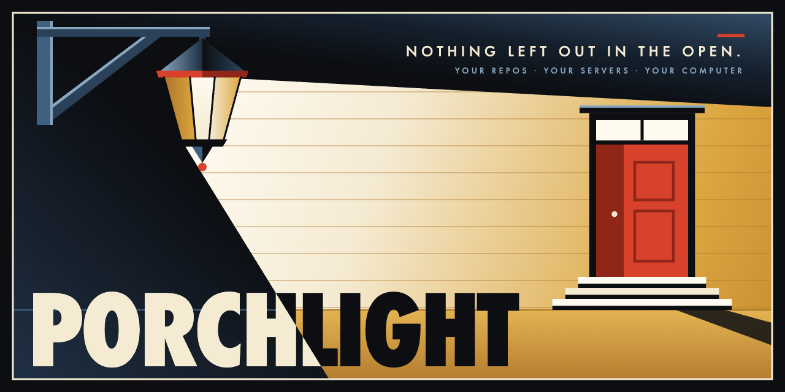
</picture>

Porchlight is a security inspection tool that runs on its operator's own computer. It inspects four things:

1. **Code.** Every git repository under a folder, including its full commit history, for committed credentials (gitleaks) and dependencies with published advisories (osv-scanner).
2. **Websites.** Domains the operator has proven to own with a DNS record, scanned daily by a Cloudflare Worker for new hostnames, DNS changes, certificate expiry and missing security headers.
3. **The Cloudflare account.** Every zone's TLS, DNS, email, firewall and bot settings, the account's members and its API tokens, checked against fixed rules that take each zone's plan into account.
4. **The computer Porchlight runs on.** Pending updates, built-in protections, programs that accept network connections, credentials stored in plain-text files, and outdated packages.

Findings are ranked by severity and grouped into an ordered repair plan. A language model can be attached to explain findings, analyse them against the code and answer questions. It is optional, it sees only what the page shows, and nothing it writes changes a finding, a count or the plan.

| | |
| --- | --- |
| Interfaces | Web interface on 127.0.0.1, command line, container image, and a desktop app for macOS |
| Platforms | Linux and macOS: command line and web interface. Any host that runs Linux containers (amd64, arm64): the container image. macOS 13.5 or later on Apple silicon: the desktop app as well. Windows: planned in [docs/PLAN-WINDOWS.md](docs/PLAN-WINDOWS.md), not yet supported |
| Requires | Node.js 22.18 or later, git, gitleaks, osv-scanner. The Mac app carries its own Node.js, gitleaks and osv-scanner |
| Runtime dependencies | None. Node runs the TypeScript directly; the web interface is plain JavaScript with no build step |
| Monitor | A Cloudflare Worker with a D1 database, deployed to the operator's own Cloudflare account. Optional |
| Demo | [porchlight.theengineers.xyz](https://porchlight.theengineers.xyz): the web interface over made-up repositories and domains. Nothing there can be scanned, changed or sent |
| Stored data | `~/.porchlight/`: reports, history, settings, keys and results, written readable only by the operator (0600) |

## Contents

Specification:

1. [Quick start](#1-quick-start)
2. [System overview](#2-system-overview)
3. [Subsystems](#3-subsystems)
4. [Operating modes](#4-operating-modes)
5. [Data that leaves the computer](#5-data-that-leaves-the-computer)
6. [Design constraints and their verification](#6-design-constraints-and-their-verification)
7. [Failure behaviour](#7-failure-behaviour)
8. [Limits](#8-limits)
9. [Interface](#9-interface)
10. [Commands](#10-commands)
11. [Environment variables](#11-environment-variables)

Reference:

- [Setup](#setup)
- [Web interface](#web-interface)
- [Mac app](#mac-app): [Download it](#download-it) · [Verify a download](#verify-a-download) · [Build it from a checkout](#or-build-it-from-a-checkout) · [Settings](#settings)
- [Open it from other devices](#open-it-from-other-devices)
- [Run on BoxPilot](#run-on-boxpilot): [Container](#container)
- [Model](#model): [Choose it in Settings](#choose-it-in-settings) · [Download a local model](#download-a-local-model) · [Set it at start-up](#or-set-it-when-porchlight-starts) · [What a model is sent](#what-a-model-is-sent)
- [Scan repositories](#scan-repositories): [Before a commit](#before-a-commit) · [On a schedule](#on-a-schedule) · [Private data](#private-data) · [How deep a scan goes](#how-deep-a-scan-goes) · [A software bill of materials](#a-software-bill-of-materials)
- [Deeper analysis with a model](#deeper-analysis-with-a-model)
- [Fetch repositories from GitHub](#fetch-repositories-from-github)
- [Export a repair roadmap](#export-a-repair-roadmap): [A mural for the export](#a-mural-for-the-export)
- [Send to a model](#send-to-a-model)
- [Discussions](#discussions)
- [Projects](#projects)
- [History, status and notes](#history-status-and-notes)
- [Investigate with a model](#investigate-with-a-model)
- [Check the computer](#check-the-computer)
- [Audit your Cloudflare account](#audit-your-cloudflare-account)
- [Monitor domains](#monitor-domains): [How it works](#how-it-works) · [Run locally](#run-locally) · [Deploy](#deploy) · [Use it](#use-it) · [Settings](#settings-1) · [Limits](#limits)
- [Development](#development)

## 1. Quick start

```bash
brew install node gitleaks osv-scanner
git clone https://github.com/AES256Afro/Porchlight.git
cd Porchlight
npm install -g ./cli
porchlight ui --root ~/Projects
```

Open the link it prints and choose **Scan your code**. `porchlight doctor` lists anything missing and the command that installs it.

`npm install -g ./cli` puts `porchlight` on your PATH. The CLI has no dependencies, so it downloads nothing; `npm uninstall -g porchlight` removes it. Without it, run `node cli/bin/porchlight.js` in its place. A scan and the page need nothing else: `npm run setup` is for working on Porchlight and for deploying the monitor (see [Development](#development) and [Monitor domains](#monitor-domains)), and installs about 450 MB of their packages.

The commands above use Homebrew, which runs on macOS and Linux. Without it, install Node.js 22.18 or later, git, gitleaks and osv-scanner from their own releases or the distribution's packages.

On a Mac with Apple silicon, the alternative is `Porchlight-<version>-arm64.dmg` from the [latest release](https://github.com/AES256Afro/Porchlight/releases/latest); see [Mac app](#mac-app) and [Verify a download](#verify-a-download).

## 2. System overview

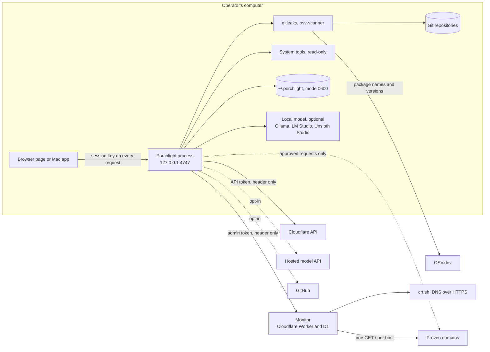

Porchlight is one Node.js process. The browser page and the Mac app are clients of the server it runs on 127.0.0.1. The page is never sent the monitor's admin token, a model's API key, the GitHub token or the Cloudflare token; the server adds them to its own requests. The scanners and the system tools run as child processes, with arguments passed as an array (no shell) and a time limit on each. The domain monitor is a separate deployment in the operator's Cloudflare account, and Porchlight reaches it with an admin token.

## 3. Subsystems

| Subsystem | Input | Method | Output | Source |
| --- | --- | --- | --- | --- |
| Repository scanner | Git repositories under a folder (3 levels by default, at most 6), one inside another included, and repositories fetched from GitHub | gitleaks over the full history and commit and tag messages, always with `--redact`; osv-scanner over lockfiles, not run on a repository whose manifests include a file outside it; secrets re-ranked one step per weak signal (generic rule, test or example path) | Findings ranked critical, high, medium, low; a "Not covered" list for anything not scanned, folders the search passed over included | `cli/src/repos/` |
| Repair roadmap | A scan | Findings grouped into actions: one per package to upgrade, credential to rotate, or batch of doubtful matches. The upgrade target is the lowest version that clears every advisory against the package | Four phases: Fix now, Fix next, Schedule, When convenient | `cli/src/roadmap/` |
| Scan history | Each finished scan | Findings matched across scans by repository, rule or advisory, file and detail | New, fixed, and "could not be checked again" | `cli/src/repos/history.ts` |
| Domain monitor | Domains whose `_porchlight-challenge` TXT record holds their token | Certificate Transparency logs, DNS over HTTPS, one `GET /` per host without following redirects | Changes since the previous scan, findings, webhook alerts | `monitor/` |
| Cloudflare audit | Every zone in the account | Fixed rules, no model. A feature the zone's plan lacks is reported as unavailable, not as a fault | Findings per zone; 10 fixed change templates offered (the ownership record, five settings that cannot break a site, four that need a look), each sent only after approval | `cli/src/cloudflare/` |
| Host check | The computer Porchlight runs on | The operating system's own tools, read-only, each with a time limit. macOS: five areas. Linux: credentials in files and installed packages | Results by area, and the repair commands that need no decision gathered into one block | `cli/src/host/` |
| Investigation | One proven domain and its subdomains | A model proposes one action per turn from three tools (DNS lookup, one HTTP request, one TCP connect); code checks each action and asks for approval | Findings that cite evidence captured in the same run | `cli/src/investigate/` |
| Model assistance | What the page shows | Explain, Summarise, Ask, Deeper analysis, Send to a model, an export mural | Labelled text beside findings, kept as discussions | `cli/src/assist/`, `cli/src/analysis/`, `cli/src/discussions/` |
| Exports | A scan, an audit or an investigation | Markdown, HTML (no script, the page's own colours, light when printed), CSV, JSON; every value escaped for its format; actions numbered "phase.action"; a foot line with the version, the kind of scan and its time in UTC | Files under fixed names; optionally a project folder | `cli/src/roadmap/escape.ts`, `cli/src/projects/` |
| Web interface | The above | 10 pages, 13 looks, a status and note per finding; filters, order and page number kept in the address; a findings trend, one severity bar and a phase chart, each beside its table | | `cli/ui/` |

## 4. Operating modes

| Mode | Started with | Listens on | Notes |
| --- | --- | --- | --- |
| Mac app | `Porchlight.app` from the DMG, or `sh mac/build.sh --install` | 127.0.0.1 | Starts and stops the web interface with its window. Not notarized |
| Web interface | `porchlight ui` | 127.0.0.1:4747, or the next free port | Session key generated per run, carried in the address fragment |
| Command line | `porchlight repos scan`, `domains`, `host check`, `cloudflare audit`, `doctor`, `status`, `hook`, `schedule print` | | `repos scan --fail-on <severity>` exits 2 on a finding at or above it, and 1 if the scan was incomplete |
| Container | `ghcr.io/aes256afro/porchlight`, or BoxPilot's catalog | 0.0.0.0:4747 inside the container | Refuses to start without `PORCHLIGHT_UI_KEY` of 32 characters or more. The host check is off; Cloudflare changes cannot be approved |
| Other devices | Settings → Access from other devices | The Tailscale address only (100.64.0.0/10) | A separate 43-character access key. Only the page on the computer itself can turn it on or off |
| Monitor | `npx cf deploy` in `monitor/` | Cloudflare Workers | Every `/domains` route answers 503 while `ADMIN_TOKEN` is missing or shorter than 32 characters |

## 5. Data that leaves the computer

| Destination | What is sent | When |
| --- | --- | --- |
| OSV.dev | Names and versions of the packages in the repositories' lockfiles. With the host check, names and versions of installed npm and Python packages | Every repository scan, unless OSV's databases are kept locally (`--osv-db`, `PORCHLIGHT_OSV_OFFLINE`): then each ecosystem's whole database is downloaded and nothing about your packages is sent. The host check's lookup can be turned off |
| Where the operator asks (Slack, Discord, ntfy or a JSON webhook) | After a scheduled repository scan: counts, and what is new and fixed by title, repository and file. The monitor's alerts | Only with `PORCHLIGHT_NOTIFY_URL` or the monitor's `ALERT_WEBHOOK_URL` set |
| Apple | macOS's own software update query | Host check on macOS, unless turned off |
| Cloudflare API (`api.cloudflare.com`) | Read requests with the operator's token as a header; a change only after the operator approves that exact request | Cloudflare audit |
| Cloudflare DNS over HTTPS | `_porchlight-challenge` lookups; an investigation's DNS lookups; the targets of a proven zone's CNAME records | Investigation; Cloudflare audit |
| The operator's monitor | Domain names and commands, with the admin token as a header | Domains page and `porchlight domains` |
| crt.sh, DNS over HTTPS, the domain itself (from the Worker) | Domain names; one `GET /` per host | Scheduled scans of verified domains |
| A proven domain (from this computer) | DNS lookups, and each HTTP request and TCP connection the operator approved | Investigation |
| A hosted model (Anthropic, OpenAI, Google, DeepSeek) | The fields the page displays for the item asked about | Only when a hosted model is selected and asked. The page names the destination before anything is sent |
| A model server of the operator's | The same fields | When it is the selected model |
| Hugging Face | The search words and filters | Model search in Settings |
| GitHub | API requests and `git clone` over https, with the operator's token if given | Fetching repositories |
| Devices on the operator's tailnet | The web interface | Only while Access from other devices is on |

Never sent anywhere: secret values (reports do not hold them), commit author names and emails, the monitor's admin token, a domain's challenge value, and Set-Cookie values from investigated sites.

## 6. Design constraints and their verification

These hold for every release. They are numbered as the invariants in `CLAUDE.md`, which gives each one's implementation details and, under it, the same tests. `npm test` runs both packages' tests, and CI runs them on every push. Tests that need the real gitleaks skip without it (13 tests); CI sets `PORCHLIGHT_REQUIRE_SCANNERS=1`, so there a missing scanner fails them.

| # | Constraint | Verified by |
| --- | --- | --- |
| 1 | No request is made about a domain (certificate log, DNS other than the challenge record, HTTPS) until its ownership record has been confirmed in the same scan. | `monitor/test/scan.test.ts`, "ownership gate": asserts the exact list of requests; `monitor/test/waiting.test.ts` |
| 2 | The monitor only looks: one `GET /` per host, no redirects followed, no port scanning, no guessing of subdomains or paths. The one exception is an investigation the operator approves (20). | `monitor/test/scan.test.ts`, "probes at most MAX_HOSTS hosts, lists the rest, and stays within its request budget" |
| 3 | Secret values never leave the scanner. gitleaks always runs with `--redact`; reports carry no secret values, matches, author names or emails. Private data is reported by kind, file, line and count, never a value. | `cli/test/scan.test.ts`, "end to end: the real gitleaks finds a secret in history and the report never contains it"; `cli/test/private.test.ts`; `cli/test/host.test.ts`, "credential files are reported by path, kind and permissions, never by what they hold" |
| 4 | The monitor's API fails closed: without an `ADMIN_TOKEN` of 32 characters or more, every `/domains` route answers 503. | `monitor/test/api.test.ts`, "refuses to run with no token, or a weak one, configured" |
| 5 | A failed lookup is not an empty answer. It is never reported as a change and never clears a finding. A kept file that cannot be read is said, never taken for an empty one. | `monitor/test/findings.test.ts`, "stays silent about anything a failed lookup could not observe"; `monitor/test/scan.test.ts`, "a failed read changes nothing (invariant 5)"; `cli/test/conventions.test.ts`, "a kept file is read through readPrivateJson…" |
| 6 | The CLI and its page have no runtime dependencies: Node's own modules and their own files only, TypeScript run through type stripping, the page with no build step. | `cli/test/conventions.test.ts`, "the CLI and its page have no runtime dependencies…"; `npm run typecheck` |
| 7 | The web interface answers only its own page: another Host name, a cross-site Origin, or a request without the session key is refused. The monitor's admin token is never sent to the browser. | `cli/test/ui-server.test.ts`, "refuses requests addressed to any other host name", "requires the session key on every API call and refuses cross-site origins", "listens beyond loopback only with a fixed key long enough to guard it", "other devices get in only on the tailnet address, only with the access key, and cannot change access" |
| 8 | No HTML is built from scanned data. The page builds every element with `h()` (`cli/ui/dom.js`), never with `innerHTML`, and its Content-Security-Policy allows no inline script or style. | `cli/test/ui-sweep.test.ts`, "no HTML is built from strings, and no inline script or style (invariant 8, S46)" and "h() refuses markup, inline style and addresses in a scheme the page never uses (S46)" |
| 9 | The BoxPilot manifest matches the image: tailnet exposure, a read-only repositories mount, a generated key. The image is published only from a `v*` tag, after the container smoke test passes. | `npm run check:boxpilot` (`scripts/check-boxpilot-manifest.mjs`); `scripts/container-smoke.sh` |
| 10 | Triage re-ranks secrets and private data and never drops a finding. | `cli/test/triage.test.ts`, "each signal lowers the rank one step and says why" |
| 11 | Exports are escaped for their format: HTML entities, a leading apostrophe before spreadsheet formula characters in CSV, escaped text in Markdown. The HTML export has no script and loads nothing. | `cli/test/roadmap.test.ts`, "hostile text in a scan cannot become markup, a link or a formula in any format" and "renders a self-contained page with no script" |
| 12 | A suggested fix is the complete repair, planned from the whole repository whatever a filter shows. A partial export says so. | `cli/test/roadmap.test.ts`, "a filter never shrinks a fix: the upgrade shown clears the advisories the filter hides too" and "a filtered findings list still names the complete repair" |
| 13 | A model sees only what the page shows, framed as data. Its answer is shown as text, labelled with the model's name, and never acted on. A key reaches only the provider it was saved for. | `cli/test/assist.test.ts`, "explains one finding from what the page shows, framed as data"; `cli/test/ui-server.test.ts`, "a key goes only to the provider or the server address it was saved for" |
| 14 | A scanned repository is untrusted input: its `.gitleaks.toml` cannot change the rules, its `.git` cannot run a program or hide history, and no file is skipped by its name. | `cli/test/hostile-history.test.ts`, "end to end: no hostile repository runs a program, hides history or skips a file by name"; `cli/test/scan.test.ts`, "end to end: a hostile repository can neither run a program nor switch gitleaks' rules off"; step 4 of `scripts/container-smoke.sh` |
| 15 | The GitHub token reaches only GitHub, as a header or through git's environment; never an argument, an address, a report or the page. | `cli/test/github.test.ts`, "clones with git settings that run nothing a repository carries, and keeps the token out of every argument" |
| 16 | A model's analysis is advice beside a finding: it never changes a severity, a count, the roadmap or an export. An answer that is not the requested JSON becomes "unclear". | `cli/test/analysis.test.ts`, "turns the model's answer into a judgement, and anything else into 'unclear'"; `cli/test/mural.test.ts`, "the mural prompt is data in a frame, and carries no reasons, evidence or secret details" |
| 17 | History and the operator's notes sit beside findings, never in them. A finding counts as fixed only where the later scan looked again. | `cli/test/history.test.ts`, "a scanner that was missing or failed never makes a finding look fixed or new"; `cli/test/ui-server.test.ts`, "keeps the owner's status and note for a finding of the latest scan, privately, without changing it" |
| 18 | "Send to a model" names a model by Porchlight's own id and builds what is sent from the server's own report. | `cli/test/ui-server.test.ts`, "sends the roadmap or the findings to the model the owner picks, from the stored report only"; `cli/test/send.test.ts` |
| 19 | The host check only reads. A check that could not run, or whose answer is not recognised, is "Could not check", never passed. | `cli/test/host.test.ts`, "an answer that is not understood, a failure or a missing tool is never a pass" |
| 20 | An investigation stays inside the proven domain and its subdomains, re-checks ownership before every action, refuses private, loopback, link-local and CGNAT addresses, and keeps a finding only if it cites evidence from the same run. | `cli/test/investigate.test.ts`, "scope: the verified domain and its subdomains, nothing else", "ownership lost mid-run stops the run before the next action", "a host that resolves to a private address is refused after approval, before connecting", "findings are kept only with evidence this run captured" |
| 21 | The Cloudflare token is sent only to `api.cloudflare.com`, as a header. A change is one of the fixed templates, offered only for a problem the latest audit found, and sent once after approval. | `cli/test/cloudflare.test.ts`, "every request goes to Cloudflare's API with the token as a header only, and only reads"; `cli/test/cloudflare-server.test.ts`, "a change is sent only after the owner approves the exact request, once, and is recorded" |
| 22 | A discussion keeps a model's answers beside the findings; a follow-up goes only to the model it began with and adds nothing but the operator's question. | `cli/test/discussions.test.ts`, "a follow-up sends the first prompt, the answers so far and the question, dropping the oldest answers when they do not fit"; `cli/test/ui-server.test.ts`, "keeps each answer as a discussion, and answers follow-up questions from the same data" |
| 23 | Porchlight writes into a project folder only inside its `Porchlight` subfolder, under its own file names, never over an existing file. | `cli/test/projects.test.ts`, "saved files are new files, readable only by the owner, inside Porchlight's own folder"; `cli/test/ui-server.test.ts`, "a project folder gets saved exports, discussions and a log, under Porchlight's own names and nowhere else" |

## 7. Failure behaviour

| Condition | Behaviour |
| --- | --- |
| gitleaks or osv-scanner missing, or failing on a repository | That repository is listed under "Not covered". `--fail-on` exits 1. The other repositories are still scanned |
| osv-scanner cannot reach its database (exit 127, empty report) | Treated as a failure. Only exit codes 0, 1 and 128 count as a result |
| A scan is stopped | Nothing is saved. The previous scan stays as it was |
| One repository is scanned again and a scanner fails that time | The findings that scanner reported before are kept |
| A monitor DNS lookup fails | The value is stored as not observed. No change is reported and no finding is cleared |
| The certificate log is unavailable | The host list is kept and the report says so |
| A domain's challenge record disappears | Scanning stops and one alert is sent |
| A monitor scan fails | Retried after 1 hour, then every 2 hours. One alert after 3 failures in a row, and one when scans work again |
| The monitor's database lacks a migration | The API answers "The database is missing a migration" |
| The Cloudflare token may not read a setting | The check shows "Could not check" and names the permission to add |
| A batch of Cloudflare changes meets a permission the token lacks | The first refusal is recorded and the remaining changes that need it are not sent |
| An ownership lookup fails during an investigation | The run stops. A failed lookup never counts as proof |
| A host-check command does not answer | It is stopped at its time limit and its check shows "Could not check" |
| A model's answer is not the JSON asked for | The verdict is "unclear" |

## 8. Limits

| Parameter | Value | Where it is set |
| --- | --- | --- |
| Repository search depth | 3 levels (0 to 6) | `--depth`, `PORCHLIGHT_SCAN_DEPTH` |
| Scans kept in history | 50 | `cli/src/repos/history.ts` |
| Discussions kept | 200, each up to 20 answers | `cli/src/discussions/discussions.ts` |
| Earlier answers sent to a local model in a follow-up | 6,000 characters, oldest dropped first | `cli/src/discussions/discussions.ts` |
| Wait for a model's answer | 5 minutes (Explain, Summarise, Ask, Deeper analysis, an investigation's turn); 20 for Send to a model and its follow-ups; 15 for a mural | `cli/src/assist/ollama.ts`, `cli/src/ui/server.ts` |
| Deeper analysis per run | 25 items by default, at most 500 | Overview page |
| Investigation turns | 25 by default, at most 60 | Investigate page |
| Gap between investigation actions on one host | 1 second | `cli/src/investigate/engine.ts` |
| Investigation HTTP request | Body read up to 32 KiB, 15-second time limit | `cli/src/investigate/tools.ts` |
| Investigations kept | 50 | `cli/src/investigate/store.ts` |
| Time to approve a Cloudflare change | 10 minutes | `cli/src/cloudflare/apply.ts` |
| Host-check command time limit | 2 minutes; 5 for `softwareupdate` when it asks Apple | `cli/src/host/` |
| Activity view | Last 400 lines, in memory only | `cli/src/ui/server.ts` |
| `PORCHLIGHT_UI_KEY`, the monitor's `ADMIN_TOKEN` | At least 32 characters | `cli/src/ui/server.ts`, `monitor/src/api.ts` |
| Scanner time limit | 10 minutes per command | `cli/src/repos/exec.ts` |
| Monitor schedule | Every 10 minutes, one domain whose last scan is over 24 hours old | `monitor/cloudflare.config.ts` |
| Hosts probed per monitor scan | 12 (`MAX_HOSTS`), keeping a scan under the Workers Free plan's 50 outbound requests | `monitor/cloudflare.config.ts` |
| Certificate expiry warning | 14 days, at most a fifth of the certificate's lifetime | `monitor/cloudflare.config.ts` |
| Monitor scans kept per domain | 30 | `monitor/cloudflare.config.ts` |

## 9. Interface

The figures show made-up repositories checked by the real gitleaks and osv-scanner, a model running in LM Studio on the same computer, and stand-in data for the Cloudflare account, the monitor and the computer check.

<picture>
  <source media="(prefers-color-scheme: dark)" srcset="docs/screenshots/overview-dark.png">
  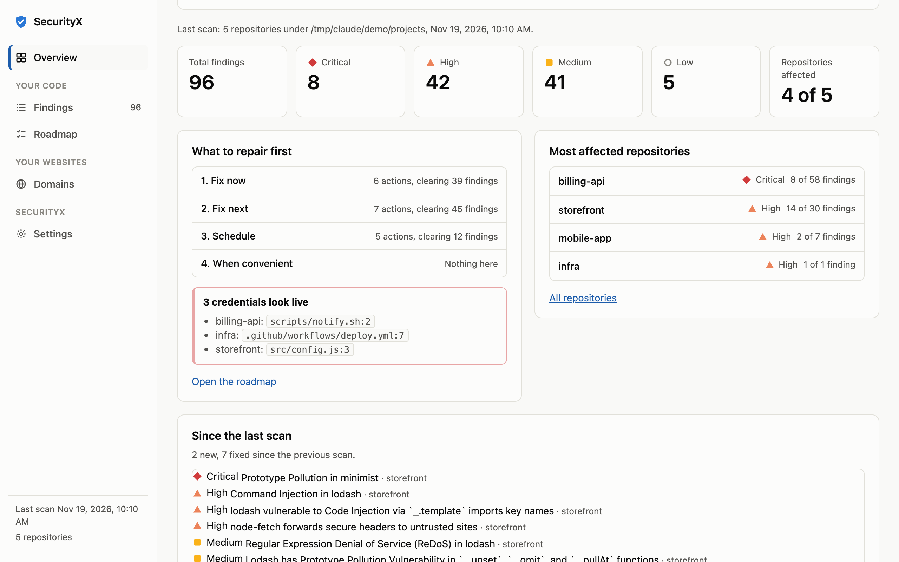
</picture>

*Figure 1. Overview: counts by severity, the four repair phases, the most affected repositories, the model's analysis, and the changes since the previous scan.*

| | |
| --- | --- |
|  | 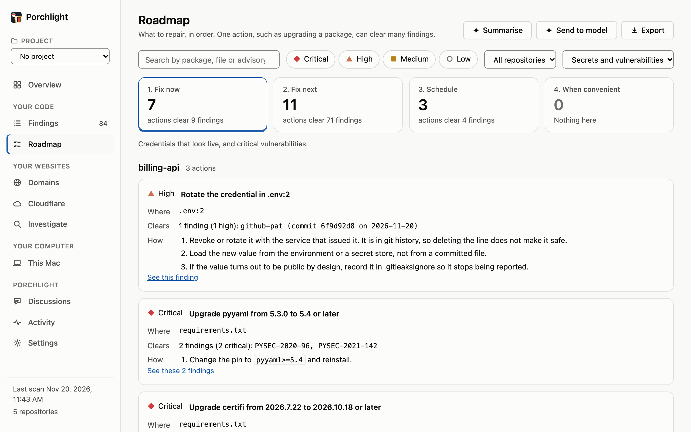 |
| *Figure 2. Findings in the Split view look, ordered by the model's verdict* | *Figure 3. Roadmap* |
| 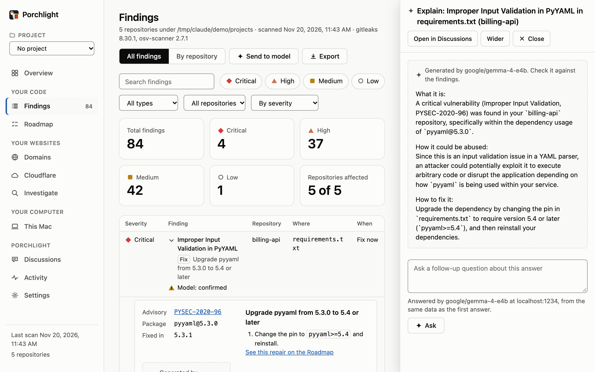 | 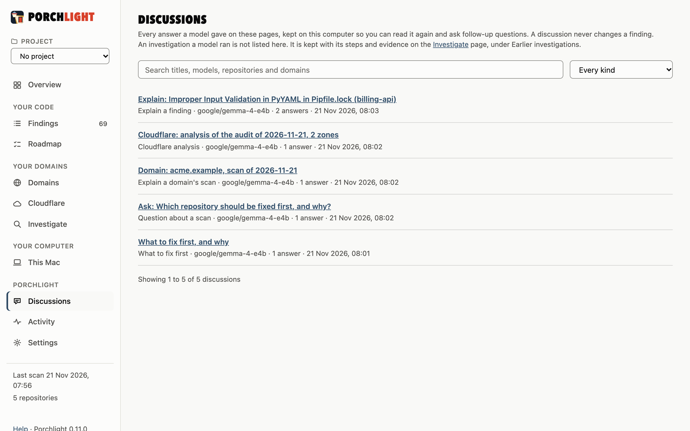 |
| *Figure 4. Explain, answered in the panel on the right* | *Figure 5. Discussions* |
| 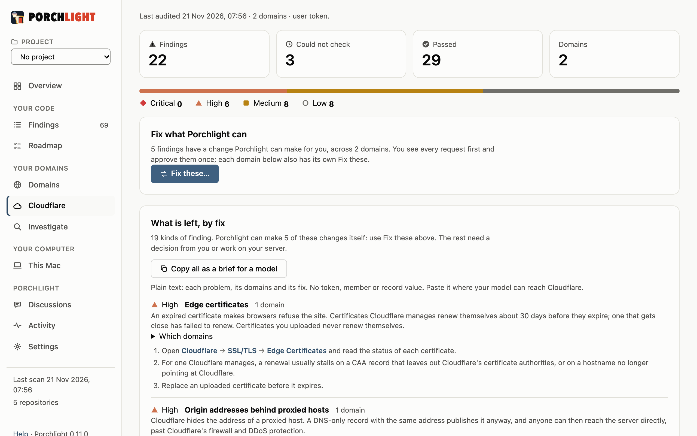 | 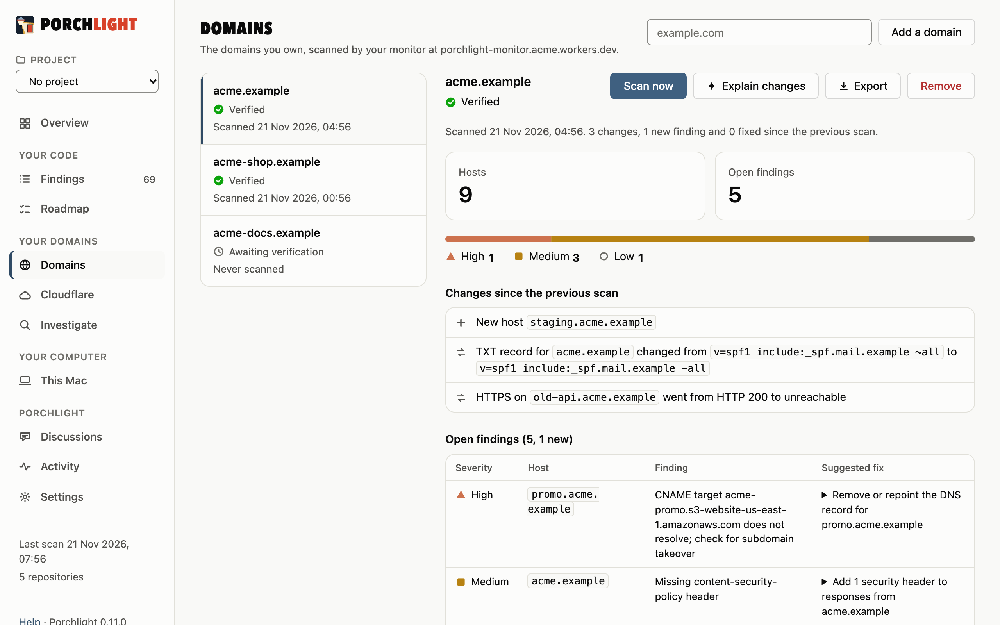 |
| *Figure 6. Cloudflare audit* | *Figure 7. Domains, from the monitor* |
| 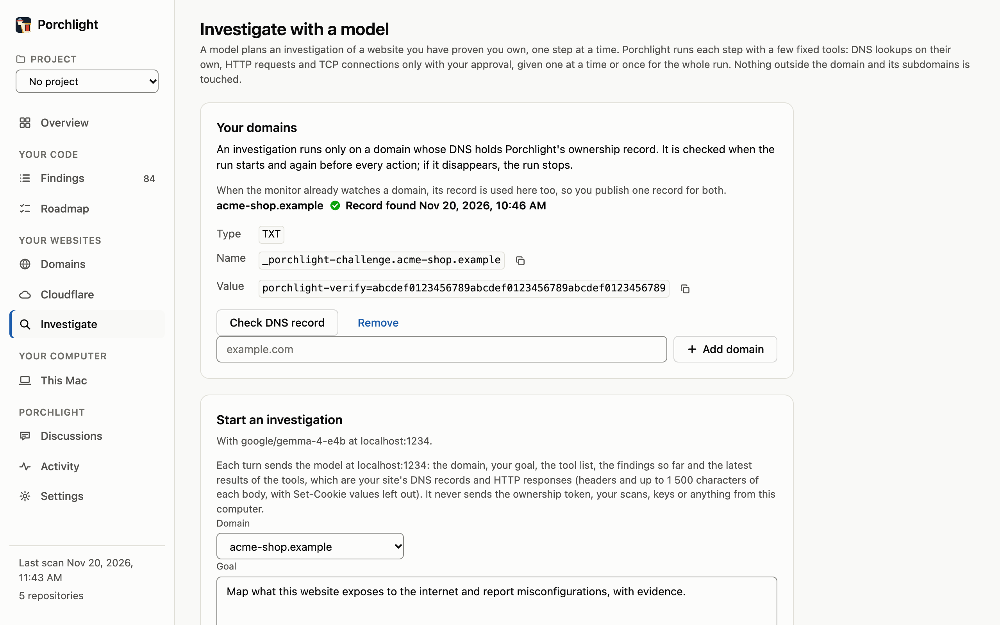 | 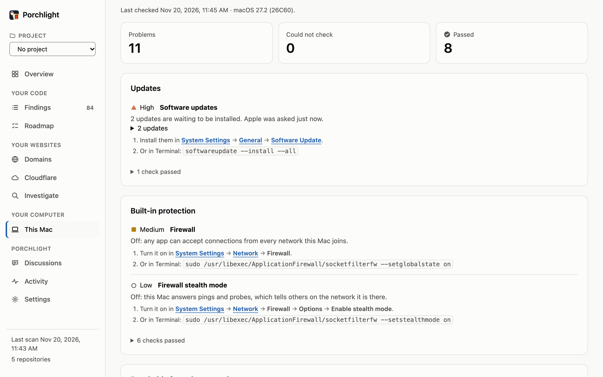 |
| *Figure 8. Investigate* | *Figure 9. The computer check* |
| 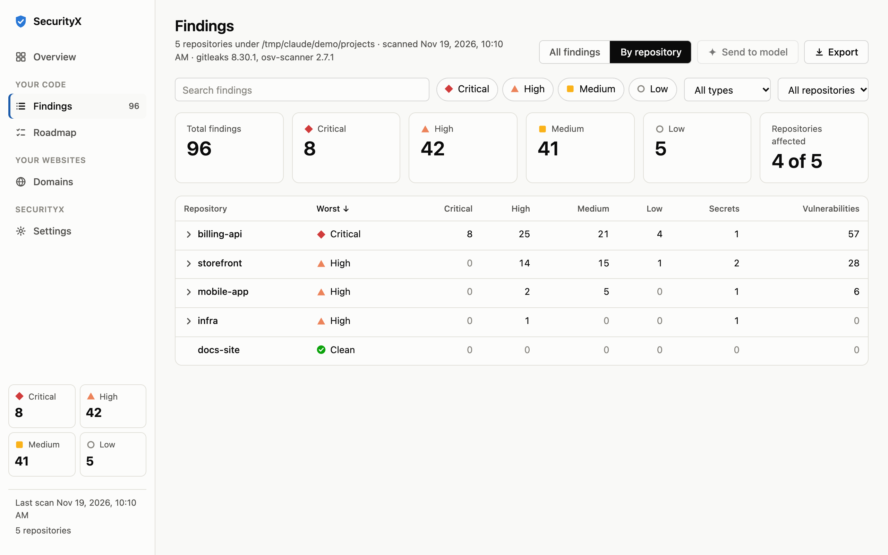 | 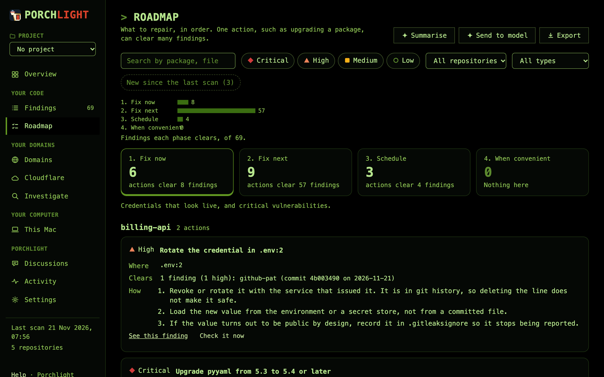 |
| *Figure 10. By repository, in the Severity dashboard look* | *Figure 11. Roadmap, in the Terminal look* |
| 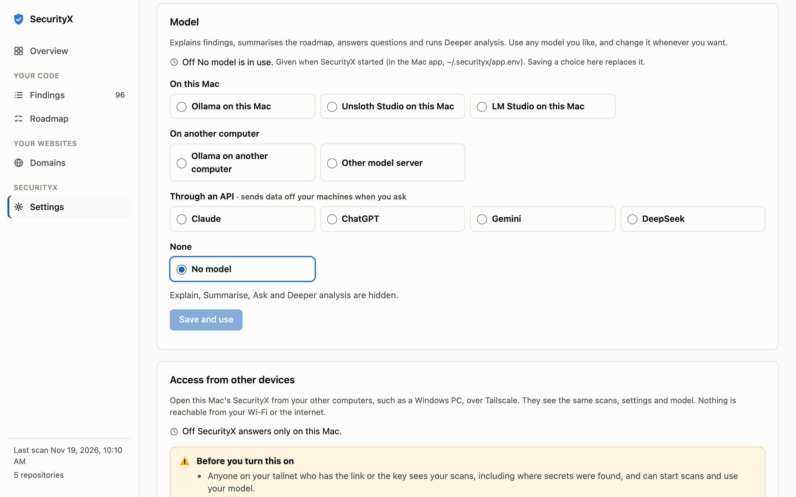 | 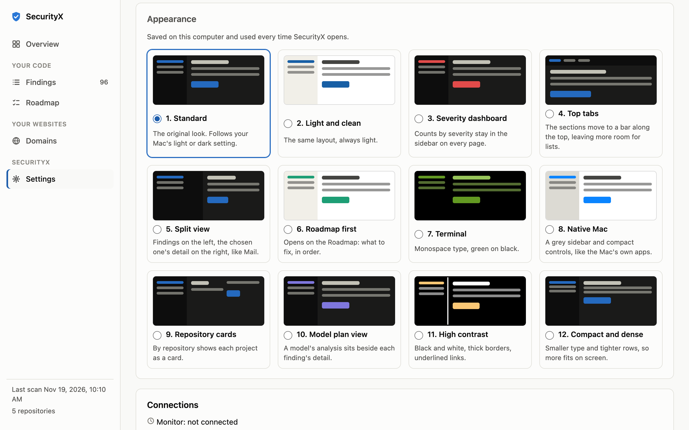 |
| *Figure 12. Settings → Model* | *Figure 13. Settings → Appearance* |

## 10. Commands

`porchlight <command> --help` prints one command's options (`cli/src/help.ts`); `porchlight --version` prints the version.

| Command | What it does |
| --- | --- |
| `porchlight repos scan` | Scan git repositories for committed secrets, vulnerable packages and private data |
| `porchlight repos history` | List the kept scans, with what was new and fixed in each |
| `porchlight repos export` | Turn a JSON report into a repair roadmap or a list of findings |
| `porchlight repos sbom` | List every package the repositories use, as a CycloneDX SBOM |
| `porchlight findings note` | Set a finding's status and note, as on the Findings page |
| `porchlight findings notes` | List your statuses and notes |
| `porchlight domains` | Register, verify and scan the domains your monitor watches |
| `porchlight host check` | Check this computer: updates, protection, open services, credentials in files |
| `porchlight cloudflare audit` | Check every domain in your Cloudflare account against built-in rules |
| `porchlight ui` | Open the local web interface |
| `porchlight doctor` | Check that Porchlight has what it needs, and say what to fix |
| `porchlight forget` | List, then remove, everything Porchlight keeps on this computer |
| `porchlight status` | What Porchlight last found, from the files it keeps; contacts nothing |
| `porchlight hook` | Check the staged files for secrets and private data before a commit |
| `porchlight schedule print` | Print a launchd or systemd unit that scans a folder on a schedule |

Exit codes: an error (an unknown option, a file that cannot be read, a service that refused) exits 1. A scan, check or audit that ran exits 0 whatever it found, unless `--fail-on <severity>` is given (`repos scan`, `host check`, `cloudflare audit`): then it exits 2 when a finding is at or above that severity, otherwise 1 when something could not be scanned or checked, otherwise 0. `doctor` exits 1 when something Porchlight cannot work without is missing.

## 11. Environment variables

Read when Porchlight starts. A choice saved in the interface's Settings comes first where one exists.

| Variable | Meaning | Read by |
| --- | --- | --- |
| `PORCHLIGHT_UI_KEY` | A fixed key of at least 32 characters. Needed to listen on any address but loopback (the container) | `ui` |
| `PORCHLIGHT_MONITOR_URL`, `PORCHLIGHT_ADMIN_TOKEN` | The monitor's address and admin token, when none is saved under Settings → Monitor | `ui`, `domains`, `doctor` |
| `PORCHLIGHT_LLM_PROVIDER` | `ollama` (default), `compatible`, `anthropic`, `openai`, `gemini` or `deepseek`; see [Deeper analysis](#deeper-analysis-with-a-model) | `ui`, `doctor` |
| `PORCHLIGHT_LLM_URL`, `PORCHLIGHT_LLM_MODEL` | A model server's address and the model's name | `ui`, `doctor` |
| `PORCHLIGHT_LLM_API_KEY` | A hosted provider's key, or a key for the operator's own server | `ui` |
| `PORCHLIGHT_GITHUB_TOKEN` | A GitHub token for fetching private repositories | `ui`, `doctor` |
| `PORCHLIGHT_CLOUDFLARE_TOKEN` | A Cloudflare API token, when none is saved under Settings → Cloudflare | `ui`, `cloudflare audit`, `doctor` |
| `PORCHLIGHT_SCAN_DEPTH` | Folder levels a scan looks through, 0 to 6 (default 3) | `ui` |
| `PORCHLIGHT_SCAN_EVERY_HOURS` | Scan `--root` again this often while the server runs, 1 to 720 | `ui` |
| `PORCHLIGHT_OSV_OFFLINE` | `true`: keep OSV's databases in the data folder and compare against them | `ui` |
| `PORCHLIGHT_NOTIFY_URL`, `PORCHLIGHT_NOTIFY_FORMAT` | Where a scheduled scan's outcome is sent, and as `json`, `slack`, `discord` or `ntfy` | `ui` |
| `PORCHLIGHT_GIT_SAFE_DIRECTORY` | Folders git may read though another user owns them, separated as in PATH (the container sets `/repos` and `/repos/*`) | every scan |
| `PORCHLIGHT_REQUIRE_SCANNERS` | `1`: a test that needs gitleaks fails instead of skipping (CI) | `npm test` |
| `PORCHLIGHT_ROOT` | The folder the Mac app offers, in `~/.porchlight/app.env` | Mac app |
| `PORCHLIGHT_STOP_WITH_STDIN` | `1`: the server stops when its standard input closes (set by the Mac app) | `ui` |

Variables named `SECURITYX_…`, from before the rename, are still read when the `PORCHLIGHT_…` one is not set.

## Setup

The [quick start](#1-quick-start) is all a scan needs. To work on Porchlight itself, `npm run setup` installs both packages' development tools and enables the pre-commit hook that blocks commits containing secrets.

Requirements:

- Node.js 22.18 or later. The `cf` CLI release candidate asks for 22.23+, 24.22+ or 26.12+ and warns on older versions.
- [gitleaks](https://github.com/gitleaks/gitleaks) for secret scanning: `brew install gitleaks`, or a binary from its releases
- [osv-scanner](https://github.com/google/osv-scanner) for dependency scanning: `brew install osv-scanner`, or a binary from its releases

The examples below assume `porchlight` is on your PATH (`npm install -g ./cli`, from the project root), or this alias:

```bash
alias porchlight="node $PWD/cli/bin/porchlight.js"
```

```bash
porchlight doctor            # what Porchlight has and what it lacks, with the fix for each
porchlight repos scan --help # the options of one command
porchlight --version
```

`porchlight doctor` checks Node, git and the two scanners, the folder Porchlight keeps its files in, and the settings for the monitor (given in the environment or saved under Settings → Monitor), the model, GitHub and Cloudflare. It only reads and prints no secret. It asks the monitor and a local model whether they answer, unless you add `--offline`; a hosted model is never contacted. It exits 1 when something Porchlight cannot work without is missing.

`porchlight doctor --self` checks what Porchlight promises on this computer: that the data folder and every folder in it are 0700 and Porchlight's own files 0600, which addresses it listens on, which keys and tokens are saved and where (by name, never the value, including keys for a model no longer chosen), whether the saved Cloudflare token has made changes and so can write, which gitleaks and osv-scanner run (path and version), and temporary files a crash left behind. It only reads.

`porchlight forget` lists what Porchlight keeps on this computer: the scan and its history, your notes, keys and tokens, fetched repositories, audits, investigations and discussions. With `--yes` it removes them. It removes only those, by name: anything else in the data folder, a link, a project folder or a git repository is left alone. It also lists what lives elsewhere: the monitor's domains, the DNS records you published, changes made to Cloudflare, and keys to revoke with each provider.

## Web interface

```bash
porchlight ui
```

It prints a link. Open it to get both tools in the browser:

- **Overview**: the two jobs, "Scan your code" and "Scan your domains". Before a scan it names the repositories it found in the folder, and whether git and each scanner is ready, with the command that installs one that is not; when it finds none, or the monitor is not set up, it says what to do next in numbered steps. The home folder itself is looked through only when you ask, as it holds Desktop, Documents and Downloads. After a scan, **At a glance** gives one line for your code, your domains, Cloudflare and this computer: how old each is, what is new and fixed since the time before, and the worst finding. **Check everything** scans your code with the last scan's options (without a model), audits Cloudflare and checks this computer, each only reading. Below it are where things stand, what needs doing first, and, with a schedule, when it last ran and how, when it runs next, whether the last notice was delivered and a token that ends within two weeks. A scan that is running can be stopped; nothing is saved, and the last scan stays as it was.
- **Findings**: every finding in one list, most severe first, each with the repair that clears it, with a copy button beside each command. Switch to **By repository** to see them grouped. Filter by severity, type, repository, text, or **New since the last scan**; the filters are kept in the address, so a reload or a shared link shows the same view. After a fix, open a repository under By repository and choose **Scan this repository again** to check it alone. Where a scanner is missing or fails that time, what it found before is kept.
- **Roadmap**: what to repair, in order. One action, such as upgrading a package, can clear many findings. A chart above the phases shows how many findings each clears.
- **Domains**: add a domain by its name, prove it is yours with one DNS record, scan, and read what changed, with a suggested fix for each finding. Until the monitor is connected the page walks through setting it up, with each command to copy. Connect it under **Settings → Monitor**: paste the monitor's address and admin token, Porchlight asks the monitor whether they work, and the page becomes your list of domains with no restart. **Check connections**, there and in Settings, asks the monitor and a local model whether they answer now, so "connected" means working. The page says when domains are overdue: the monitor scans 144 a day. The two can also be given at start-up as `PORCHLIGHT_MONITOR_URL` and `PORCHLIGHT_ADMIN_TOKEN` (see [Monitor domains](#monitor-domains)); a connection saved in Settings comes first.
- **Cloudflare**: audit every zone in your Cloudflare account and approve fixed changes; see [Audit your Cloudflare account](#audit-your-cloudflare-account).
- **Investigate**: a model plans an investigation of a domain you have proven is yours, one approved request at a time; see [Investigate with a model](#investigate-with-a-model).
- **This Mac** (**This computer** on Linux): check the computer Porchlight runs on; see [Check the computer](#check-the-computer).
- **Discussions**: every answer a model gave on these pages, with your follow-up questions; see [Discussions](#discussions).
- **Activity**: what Porchlight is doing as it happens, the last 400 lines, kept in memory only.
- **Project** (above the sections): which project folder saved exports, discussions and the log go to; see [Projects](#projects).
- **Settings**: add project folders under **Projects** (see [Projects](#projects)), pick one of thirteen looks under **Appearance** (Standard, Light, Severity dashboard, Top tabs, Split view, Roadmap first, Terminal, Native Mac, Repository cards, Model plan view, High contrast, Compact, Poster moderne), each previewed in its own colours, and where a model's answers appear: in a panel on the right (the default), below what you asked about, or in a drawer at the bottom. Both are saved in the data folder (`ui-settings.json`) and used every time Porchlight opens. It also lists what Porchlight is connected to, its version, and under **Data** the notes that match no kept finding. **Help** and the version are at the foot of the sidebar on every page. While an investigation waits for your approval, the Investigate section says so and the tab's title starts "(Waiting)", from any page.

Every page with findings has an **Export** button; see [Export a repair roadmap](#export-a-repair-roadmap). Beside it, **Send to model** sends the roadmap or the findings to a model you choose; see [Send to a model](#send-to-a-model).

Porchlight keeps every scan, and the Overview's **Since the last scan** card says what is new and what was fixed; see [History, status and notes](#history-status-and-notes). You can give each finding a status and a note, and the page opens where you left it.

With a model connected (Settings → Model), findings, the roadmap and domains also get **Explain** and **Summarise** buttons, and the Overview takes questions; see [Model](#model).

| Option | Effect |
| --- | --- |
| `--port <n>` | Port to listen on (default 4747; on this machine, the next free port if another copy already has it) |
| `--host <address>` | Address to listen on (default 127.0.0.1). Any other address needs `PORCHLIGHT_UI_KEY`; see [Run on BoxPilot](#run-on-boxpilot) |
| `--report <file>` | Scan report to show and update (default `repo-scan.json` in the data folder). Its history, your notes on findings and the model's judgements are kept beside it |
| `--data <folder>` | Where settings, keys, tokens, fetched repositories, audits and discussions are kept (default `~/.porchlight`; `/data` in the container). An earlier version kept them beside the report; they are moved here when Porchlight starts, so a report kept in a project's folder never draws keys into it |
| `--root <dir>` | Folder offered in the scan form (default: the current folder) |

To browse a report made on the command line with `--json`, pass it with `--report`.

How the interface is protected:

- It listens on 127.0.0.1 only.
- The link carries a session key generated for that run. Every request for data needs it, so other pages in your browser, and other users of the machine, get nothing. The key is kept for that tab and removed from the address bar.
- It refuses requests addressed to any other host name or sent from another site.
- The monitor's admin token stays in the Porchlight process. The browser never receives it.
- A local model is asked by the Porchlight process, from its own copy of the report. The page only names what to explain.
- The page loads nothing from the network, and has no dependencies or build step.

## Mac app

Porchlight.app opens Porchlight like any other app, with no terminal. It starts the web interface, shows it in its own window, and stops it when the window closes. If a scan, an analysis or a model's answer is still running when you close the window or quit, it asks first (**Keep Working** or **Quit Anyway**); everything else is saved as it changes, and it opens on the page you left. Exports are saved to Downloads, and links to advisories open in your browser.

### Download it

On a Mac with Apple silicon (M1 or later) and macOS 13.5 or later:

1. Download `Porchlight-<version>-arm64.dmg` from the [latest release](https://github.com/AES256Afro/Porchlight/releases/latest), and check it as [Verify a download](#verify-a-download) describes.
2. Open it and drag Porchlight into Applications.
3. Open Porchlight. It is not notarized by Apple, so the first time macOS says "Porchlight Not Opened". Choose **Done**, then open System Settings → Privacy & Security and choose **Open Anyway** beside "Porchlight was blocked". After that it opens like any other app.

The app carries its own Node.js, gitleaks and osv-scanner, so nothing else needs installing except git: macOS offers Apple's command line tools the first time a scan needs them. If you install newer scanners with Homebrew (`brew install gitleaks osv-scanner`), it uses those instead.

### Verify a download

From the first release whose DMG CI built, each release carries `SHA256SUMS` beside the DMG, and both the DMG and the container image have a GitHub artifact attestation: a statement, signed through Sigstore, of the repository, workflow and commit that built the file. Earlier releases have neither.

The checksum, in the folder that holds the DMG and `SHA256SUMS`, both from the release page:

```bash
shasum -a 256 -c SHA256SUMS
```

It prints `Porchlight-<version>-arm64.dmg: OK`. A checksum shows that the file is the one listed, not who built it.

The attestation, with the [GitHub CLI](https://cli.github.com) signed in (`gh auth login`):

```bash
gh attestation verify Porchlight-<version>-arm64.dmg --repo AES256Afro/Porchlight --source-ref refs/tags/v<version>
gh attestation verify oci://ghcr.io/aes256afro/porchlight:<version> --repo AES256Afro/Porchlight --source-ref refs/tags/v<version>
```

Each succeeds only when the file's digest matches one that this repository's CI built from the tag `v<version>`; anything else is an error. The image under its earlier path, `ghcr.io/aes256afro/securityx`, is the same image with the same attestation. The image also carries buildx's SBOM and provenance: `docker buildx imagetools inspect ghcr.io/aes256afro/porchlight:<version> --format '{{ json .Provenance }}'`.

### Or build it from a checkout

```bash
sh mac/build.sh --install
```

This puts `Porchlight.app` in `~/Applications`, running `porchlight ui` from this checkout. It needs the Xcode command line tools (`xcode-select --install`), and it's built for this machine: it runs the `node`, gitleaks and osv-scanner that were on your PATH when you built it, so rebuild after moving the checkout or changing Node.

`sh mac/build.sh --dmg` makes the download instead: `mac/build/Porchlight-<version>-arm64.dmg`, with the CLI from the last commit (never uncommitted changes) and copies of the `node`, gitleaks and osv-scanner on your PATH, with their licences. It checks that each runs on another Mac, and the app holds no path, name or setting of the machine that built it.

### Settings

Settings are read from `~/.porchlight/app.env` each time it starts (copy `mac/app.env.example`): the folder to offer, the monitor's address and admin token, a model, a GitHub token. An app built from a checkout reads the admin token from `monitor/.secrets.production` when only the monitor's address is set. The model and the look are chosen in the app, under Settings. The interface's own log is in `~/.porchlight/app.log` (Porchlight → Show Log).

## Open it from other devices

Porchlight can also be opened from your other devices, such as a Windows PC or a phone, over [Tailscale](https://tailscale.com). They use the same running copy: the same scans, settings and model.

1. On the computer that runs Porchlight, open **Settings → Access from other devices** and choose **Turn on**.
2. Copy the link it shows. It looks like `http://your-computer.your-tailnet.ts.net:4747/#k=…` and carries the access key.
3. Open that link on the other device. The page takes the key from the link and removes it from the address bar. To open the page again later, keep the access key in a password manager and paste it when the page asks for it. Do not bookmark the link: a bookmark holds the key, and bookmarks sync to a browser account.

How it is protected:

- Porchlight listens on that computer's Tailscale address only, on port 4747. Your Wi-Fi network and the internet get no answer.
- Other devices need the access key: 43 random characters, kept in `access.json` in the data folder and readable only by you. It is a different key from the one that computer's own page uses.
- Only the page on that computer can turn access on or off, see the key, or **Make a new key**, which signs every device out.
- Tailscale encrypts the connection. If other people share your tailnet, limit who can reach that computer with Tailscale's access controls.
- It works while Porchlight is running there. Stopping `porchlight ui`, or closing the Mac app's window, stops it for every device. If Tailscale isn't connected yet, Porchlight keeps checking every 30 seconds.

## Run on BoxPilot

Porchlight is in the [BoxPilot](https://github.com/AES256Afro/BoxPilot) catalog: install it from Apps → Browse like any other app. BoxPilot runs the public image `ghcr.io/aes256afro/porchlight` (published under its earlier path too, which servers installed before the rename still pin), the web interface with gitleaks and osv-scanner built in. The monitor still runs on Cloudflare; the image is only its client. [Verify a download](#verify-a-download) shows how to check that an image was built by this repository's CI.

- **Repositories to scan**: fetch them from GitHub on the page (see [Fetch repositories from GitHub](#fetch-repositories-from-github)), or use a folder of checkouts on the server (default `/srv/projects`), mounted read-only at `/repos`. Both are scanned together.
- **GitHub token**: optional, `PORCHLIGHT_GITHUB_TOKEN`, for fetching private repositories.
- **Cloudflare API token**: optional, `PORCHLIGHT_CLOUDFLARE_TOKEN`, a read-only token for the Cloudflare page (see [Audit your Cloudflare account](#audit-your-cloudflare-account)). On BoxPilot the audit only reads; changes to the account are approved only on a computer that runs Porchlight itself.
- **Access key**: BoxPilot generates `PORCHLIGHT_UI_KEY`. The page asks for it once per browser tab.
- **Monitor address and admin token**: optional, for the Domains page.
- **Folder levels to look through**: `PORCHLIGHT_SCAN_DEPTH`, 0 to 6 (default 3).
- **Scan again by itself**: `PORCHLIGHT_SCAN_EVERY_HOURS`. Empty scans only when you ask; 24 scans once the last scan is a day old. The page then shows what is new and what was fixed.
- **Keep the vulnerability databases on this server**: `PORCHLIGHT_OSV_OFFLINE`. On, OSV's databases are kept on the data volume (`/data/osv-db`) and package names are not sent to api.osv.dev.
- **Send each scheduled scan's outcome to**: optional, `PORCHLIGHT_NOTIFY_URL`, a Slack or Discord webhook, an ntfy topic, or any address that takes JSON (`PORCHLIGHT_NOTIFY_FORMAT` picks the format when the address does not show it). After a scan the schedule ran, it gets the counts, what is new and what was fixed, by title, repository and file, or that the scan failed. Never a secret's value or a commit's author. A scan you start from the page sends nothing.
- It starts on the tailnet only, because a report names the files and commits where secrets were found.
- Each line of the Activity page is also printed to the container's output, with its time, so `docker logs porchlight` shows when scans ran, how they ended and whether a notice was delivered. Like the Activity page, these lines never hold a key, a token, a secret's value or a model's text.

### Container

Outside BoxPilot, run the image directly. Replace `<version>` with a release's version, such as `0.10.0`:

```bash
export PORCHLIGHT_UI_KEY="$(openssl rand -hex 32)"   # keep it: the page asks for it
docker run -d --name porchlight -p 127.0.0.1:4747:4747 -e PORCHLIGHT_UI_KEY \
  -v "$HOME/Projects:/repos:ro" -v porchlight-data:/data ghcr.io/aes256afro/porchlight:<version>
```

In the container, `porchlight ui --host 0.0.0.0` changes what protects it:

- It refuses to start without `PORCHLIGHT_UI_KEY` of at least 32 characters, and never prints it.
- It answers to any host name (a Tailscale name, a LAN address), so the key on every request is what guards the data. A cross-site Origin is still refused; only its host part is compared, because Tailscale Serve puts HTTPS in front.
- `GET /healthz` answers without the key, for the container's health check.

Releasing a version, including the image, the Mac app and the BoxPilot manifest, is described in [RELEASING.md](RELEASING.md).

## Model

A model can explain what a scan found, in the web interface. It is optional: without one, these buttons are not shown. Use any model you like, and switch whenever you want.

- **Explain** on a finding (Findings, and By repository): what it is, how it could be abused, and how to fix it.
- **Summarise** on the Roadmap: a short "fix this first, and why". It covers the whole roadmap, whatever the filters show.
- **Explain changes** on a domain: the monitor's latest report for it (hosts added or gone, DNS changes, certificates, missing headers, findings) as a short summary.
- **Ask about this scan** on the Overview: questions answered from the stored report only.

### Choose it in Settings

Open **Settings → Model** and pick where it runs:

| Choice | Address offered | Key |
| --- | --- | --- |
| Ollama on this computer | `http://localhost:11434` | none |
| Unsloth Studio on this computer | `http://localhost:8888/v1` | if Studio asks for one (Settings → API in Studio) |
| LM Studio on this computer | `http://localhost:1234/v1` | if set |
| Ollama on another computer | its address, such as `http://my-server:11434` | none |
| Other model server | any address that speaks OpenAI's format (llama.cpp, vLLM, OpenRouter) | if it asks for one |
| Claude, ChatGPT, Gemini, DeepSeek | fixed in the code | your API key |
| No model | | |

**Find models** lists what that server or account offers. **Send a test message** checks the whole connection. **Save and use** switches at once, with no restart.

- The choice is kept in `model-settings.json` beside the report (`~/.porchlight/` by default), readable only by you. It replaces whatever Porchlight was started with; **Use the start-up model** goes back to that.
- An API key is typed into Settings once and kept in that file. The page is never sent it back, and it never appears in a log or a report.
- Each hosted provider's key is kept for that provider only, so switching from Claude to a local model never sends Claude's key anywhere. A key for your own server is tied to the address it was saved with.
- A ChatGPT or Claude subscription is not an API key. These need a key from the provider's developer console, billed per request.
- Before you choose a hosted provider, the page says what would be sent there. Saving the choice sends nothing.

### Download a local model

Under the model form, **Download a model** finds a model that runs on your own computer and has [Ollama](https://ollama.com/download) download it. Porchlight runs no model itself, so Ollama has to be installed and open; the section says so, with a link, when it is not.

- **Search Hugging Face** by words, kind (text and chat, reads images too, embeddings), order (most downloaded, most liked, trending, recently updated, newest), publisher and tag, and by format and size. The format is GGUF, which Ollama runs, or MLX, Apple's format for Apple silicon: Ollama cannot run MLX, so an MLX result gives its name to copy and a link to its page, to load in Unsloth Studio or LM Studio and then choose in the form above. Size is how many billion parameters the model's name says it has (up to 4B, 5B to 9B, and so on). The section says what this computer is (its processor and memory) and how large a model should run comfortably on it, about half its memory, and **Only models that fit this computer** keeps the search to those; a model whose name does not give its size is left out when a size is asked for. The search sends what you typed and chose to huggingface.co and nothing else: no key, and nothing from a scan.
- **Download** asks Ollama to pull the model and shows how far it is. One download at a time; **Stop** ends it, and Ollama keeps what it already has. You can leave the page: the Activity page says when it is done.
- **Use this model** makes it the model Porchlight uses, the same as choosing it in the form above.
- You can also name one of Ollama's own models, such as `qwen3:8b`.

Anyone can publish a model on Hugging Face, so prefer publishers you recognise. A model is several gigabytes. Models are searched for and downloaded only from the page on the computer that runs Porchlight, never from another device or when it runs as a service.

### Or set it when Porchlight starts

The model can also be given in the environment when `porchlight ui` starts, never on the command line. A choice saved in Settings takes precedence. For Ollama, two settings:

| Setting | Meaning |
| --- | --- |
| `PORCHLIGHT_LLM_URL` | Ollama's address, such as `http://localhost:11434`. Empty turns the features off |
| `PORCHLIGHT_LLM_MODEL` | The model's name, as `ollama list` shows it |

An address without a model, or one that is not an http or https address, is shown in the interface as a setting to correct.

```bash
ollama pull hf.co/hauhaucs/qwen3.5-9b-uncensored-hauhaucs-aggressive:Q4_K_M
export PORCHLIGHT_LLM_URL=http://localhost:11434
export PORCHLIGHT_LLM_MODEL=hf.co/hauhaucs/qwen3.5-9b-uncensored-hauhaucs-aggressive:Q4_K_M
porchlight ui
```

On BoxPilot:

1. Install the Ollama app from Apps → Browse.
2. In its Models tab, add `hf.co/hauhaucs/qwen3.5-9b-uncensored-hauhaucs-aggressive:Q4_K_M`.
3. In Apps → Porchlight → Settings, set **Local model address** to `http://host.docker.internal:11434` and choose that model under **Local model**. Porchlight restarts with them.

Running the image some other way, give the container a route to the host and both settings: `--add-host host.docker.internal:host-gateway -e PORCHLIGHT_LLM_URL=http://host.docker.internal:11434 -e PORCHLIGHT_LLM_MODEL=<model>`.

### What a model is sent

This is the one description of what any model receives, local or hosted; the other sections link here.

- Only what the page already shows: for a finding, its scanner, type, severity, rule or advisory ID, title, location, commit or package, ranking note and suggested fix; repository names; the roadmap's actions; a domain report's hosts, DNS changes, findings and notes.
- Never a secret value (reports have none), an author name or email, the monitor's admin token, or a domain's verification record.
- Scan data can be written by an attacker (a file name, a package name, a DNS TXT record), so it is sent as one marked block, and the model is told that everything in it is data, not instructions.
- A large scan is cut to fit what the model can read, most severe first, and the answer says so.
- To the model chosen in Settings → Model, or given at start-up: Ollama, a server of yours that speaks OpenAI's format, or a hosted provider at an address fixed in the code. Plain http is allowed only for a model server of your own, since nothing secret is sent to it. Before anything goes to a hosted provider, the page names it and says that what is sent leaves your machines. A model on a small server is asked one question at a time.
- Deeper analysis also sends, for a vulnerable package, how it is declared and the lines of your code that import it; for a secret or private data, no file content at all.

What comes back:

- Each answer is labelled with the model that wrote it. It is generated and can be wrong: check it against the findings before acting on it.
- It is shown as plain text, never as HTML, and Porchlight never acts on it.
- Without a graphics card, a 9B model takes tens of seconds per answer. Porchlight waits up to 5 minutes for an answer, 20 for Send to a model and 15 for a mural (see [Limits](#8-limits)).

## Scan repositories

```bash
porchlight repos scan ~/Projects --out reports/repos.md
```

| Option | Effect |
| --- | --- |
| `--depth <n>` | Directory levels searched for repositories (default 3) |
| `--preset <name>` | What to look at: `quick`, `standard` (default) or `deep`. See "How deep a scan goes" below |
| `--checks <list>` | Only these checks: `secrets`, `dependencies`, `private-data`, separated by commas |
| `--history <reach>` | Git history read for secrets: `all` (default), `none` (the files as they are now), or a number of the latest commits (with the files as they are now) |
| `--local-files` | Also read files git does not track (such as `.env`) and changes not yet committed. What is found there is marked "on this computer only" and ranked one step lower |
| `--skip <name>` | Leave a repository out, by the name the report gives it. Repeat, or separate names with commas |
| `--out <file>` | Write the Markdown report to a file and print a summary |
| `--json` | Emit the report as JSON |
| `--format <form>` | `md` (default), `json` (as `--json`) or `sarif`: SARIF 2.1.0 for code-scanning tools. Each result carries the finding's rule, place and words as plain text, never a value; the run's properties list what the scan did not cover |
| `--baseline <file>` | A JSON report of an earlier scan. `--fail-on` then counts only findings it does not hold, matched as the history matches them. A finding the baseline did not look for counts as not held, and an incomplete scan still exits 1 |
| `--osv-db <folder>` | Keep OSV's databases in this folder and compare against them, so package names are not sent to api.osv.dev. The first scan downloads each ecosystem's database (npm's is about 200 MB); later scans bring them up to date |
| `--save` | Also keep the scan where the interface reads it (`~/.porchlight`), and in its history, so `porchlight ui` shows it. It replaces the scan shown there, and says what is new and fixed since the scan of the same folders before it |
| `--again <name>` | With `--save` and no folder: scan one repository of the saved scan again, by the name the report gives it, and say what that fixed ("2 fixed, 1 new in shop"). Where a scanner could not look again, what it found before is kept |
| `--fail-on <severity>` | Exit with code 2 if any finding is at or above `critical`, `high`, `medium` or `low`; exit with code 1 if a scanner was missing or failed, or the choices left something out (a check, history, a repository), so an incomplete scan never passes |

While it runs it prints one line a repository to the error stream, such as `[ 3/17] shop  1.2s  4 findings`, so the report itself can still be piped. A repository's two scanners run together, and several repositories at once, by how many cores the machine has.

What it checks:

- **Secrets** in the full commit history, with gitleaks. A secret deleted in a later commit is still reported, because it is still in history and must be rotated. Each match is ranked by how likely it is to be a live credential.
- **Dependencies** named in lockfiles, with osv-scanner, rated by CVSS score.
- **Private data**, in the Deep preset or with `--checks private-data`: personal data committed to a repository. See "Private data" below.

How secrets are ranked:

| The match is | In ordinary source | In tests, docs, examples, generated files, benchmark output or data files |
| --- | --- | --- |
| A known key format, such as an AWS key, a private key or a JWT | high | medium |
| A generic pattern that only looks like a key | medium | low |

A finding ranked below high says why. Ranking never removes a finding: a real key can sit in a test file, so the lower ranks still deserve a look.

What to know:

- Secret values are never written to the report or the terminal. gitleaks always runs with `--redact`, and author names and emails are dropped.
- A scanner that is not installed, or that failed on a repository, is listed under "Not covered" in the report. A report with that section is not a clean result. That includes gitleaks reporting nothing because git could not read a repository's history.
- A scanned repository is treated as hostile input. gitleaks always uses its built-in rules, so a repository's own `.gitleaks.toml` cannot switch detection off, and a `gitleaks:allow` comment hides nothing. gitleaks' own list of files to skip by name (lockfiles, `*.svg`, `bootstrap*.js` and others) is not used: a key in any committed file is reported. History is read from a copy Porchlight makes of each repository, which holds none of its settings, so a repository's `.git` can neither run a program nor hide commits. A partial clone is not read, and a shallow one is named under "Not covered". The programs Porchlight runs never receive its keys and tokens. Ignore files a repository carries (`.gitleaksignore`, `osv-scanner.toml`) are honoured, and the report names each one under "Left out by repository settings", since whatever they hide is not listed.
- Reading files git does not track (`--local-files`) leaves out third-party code a package manager installed beside the project (`node_modules`, virtual environments, `vendor/bundle`).
- Dependency scanning needs network access: osv-scanner sends package names and versions to the OSV database (api.osv.dev), and nothing else. It is kept from working out the packages a `requirements.txt` or `pom.xml` pulls in indirectly (that would send their names to deps.dev), from running a language's toolchain in the repository, and from sending hashes of vendored files; a repository with such a manifest says so under "Not covered". Offline, it is reported as not covered. With `--osv-db <folder>` it downloads each ecosystem's whole database there instead (npm's is about 200 MB; later scans only bring it up to date) and sends nothing about your packages.
- Uncommitted and git-ignored files are not scanned unless `--local-files` (in the interface, Options → "Files git does not track") asks for them.
- `reports/` is git-ignored: a report names the files and commits where secrets were found.

### Before a commit

`porchlight hook` checks the files staged in the repository it runs in, with the same rules as a scan (gitleaks' built-in ones and the private-data ones, never the repository's own `.gitleaks.toml`). It reads the staged content from git's objects into a private temporary folder, so no filter the repository names runs, and prints each match's kind, rule, file and line, never its value. It exits 1 when it finds something or could not check. Porchlight never writes into a repository: `porchlight hook print` prints the hook, for you to save as `.git/hooks/pre-commit` and mark executable. `git commit --no-verify` skips it once.

### On a schedule

`porchlight schedule print` prints a launchd agent (macOS) or a systemd user service and timer (Linux) that runs a Standard `repos scan --save` of one folder (`--root`, default the current folder) every `--every` hours (default 24), so the interface shows the latest. It installs nothing; the comment at its top says how. It carries no key or token, and never starts a model.

### Private data

Personal data in a repository is a leak even when it is not a key. A scan that looks for it reads the same history and files as the secrets check, with three methods:

| Kind | Found by | Told apart from noise by |
| --- | --- | --- |
| Contact details: email addresses, phone numbers | gitleaks, with Porchlight's own rules (`cli/src/repos/gitleaks-private.toml`) | Example domains (`example.com`, `.test`), fictional numbers (555-01xx) and no-reply addresses rank low or are not matched; a maintainer's address in `package.json`, a licence or an authors file ranks lower |
| Government and financial IDs: US Social Security numbers, payment card numbers, IBANs | the same rules | Published example and test numbers (Stripe's, the textbook IBANs) rank low. Cards are matched by issuer prefix and length, IBANs by country and length. No checksum is computed, since gitleaks never hands over the value |
| Location: GPS coordinates, and the GPS position in a photo's EXIF data | the rules; Porchlight's own reader for photos | Coordinates need four decimal places (a building), and a latitude between -1 and 1 is not matched, which leaves out probability pairs such as `0.12, 0.98`. No street-address pattern: it mostly matches ordinary text |
| Network internals: private addresses, Tailscale names and addresses, internal host names (`.internal`, `.corp`, `.lan`) | the rules | Ranked low, apart from Tailscale names, which name the tailnet |
| Data dumps: 20 or more contact details in one file; databases, mail and HTTP archives, contact files | the rules' counts; file type | Example values do not count towards a dump |
| Personal documents: files named like a passport, an ID card, a payslip, a bank statement, a tax form or a CV | file name and type only | Whole words of the name; a CV only among document types. The file is never opened |

- No value is kept or shown, not even masked: a finding carries its kind, file, line and a count ("25 email addresses"). The same rule in one file is one finding.
- A photo is opened only to answer whether its EXIF data holds a GPS position; the position is never read out. Photos history added and later deleted or changed are read as committed, with `git cat-file`, which converts nothing.
- Ranking follows the secrets check: each reason to doubt that it is someone's real data (an example value, a test path, project metadata, a file never committed) lowers it one step, and nothing is dropped.
- The repair for data in a committed file is to rewrite history (`git filter-repo`), one action per file, since deleting it leaves it in every earlier commit and every clone. Network names, a project's own contact details and example values get a check instead; data in files git does not track is kept out of git.
- A model judging private data gets no file content, the same as for a secret.

### How deep a scan goes

The scan form's **Options** on the Overview, and the flags above, choose what a scan looks at:

| Preset | Secrets | Dependencies | History | Afterwards |
| --- | --- | --- | --- | --- |
| Quick | the files git tracks, as they are now | yes | none | |
| Standard | every commit on every branch | yes | all | |
| Deep | every commit on every branch, and private data | yes | all | the model's deeper analysis of up to 25 critical and high findings starts (interface only) |

Under the presets are separate switches: which checks run, how much history is read (all, none, or the latest N commits together with the files as they are now), folder levels, repositories to skip, and files git does not track. Changing a switch away from a preset makes the scan "Custom". Reading files git does not track is off in every preset.

- Every report names its choices (`Scan: Quick: secrets in the files as they are now, no history, dependencies`), and anything less than Standard is listed under "Not covered": a Quick scan says that history was not read, so it never reads as a clean result. The choices are kept with the report and shown on the Overview.
- On the page, the choices are kept in the address (`#/overview?preset=quick&local=true`), so a reload or a shared link keeps them.
- "New since the last scan" and "fixed" count only what both scans looked at. After a Quick scan, a secret an earlier scan found in an old commit is counted as "could not be checked again", never as fixed.
- Reading the files as they are now: Porchlight lists the tracked files from git's index alone (`git ls-files --stage`, so no filter or other program a repository's settings name can run), copies them into a private temporary folder for gitleaks, and compares each with its committed version by git's own id. No symbolic link is followed out of the repository, and a file over 50 MB is counted under "Not covered" rather than read. A key found only in a change not yet committed is marked "on this computer only, an uncommitted change".
- A key in a file git does not track has never left the computer. It is ranked one step lower, and the roadmap's repair is to keep the file out of git (check that `.gitignore` covers it), not to rotate the key.
- Deep with a hosted model: the Options panel says, beside the Deep choice, that findings will be sent outside your machines. Pressing **Check** with that shown is the yes; a request without it never starts the analysis. A scheduled scan is always Standard and never starts the model.
- Scanning one repository again uses the report's own choices, so it covers what the report says it covers.

### A software bill of materials

```bash
porchlight repos sbom ~/Projects --out sbom.cdx.json
```

Lists every package the repositories' lockfiles name, not only the vulnerable ones, as one CycloneDX 1.5 file with a component per repository. osv-scanner reads the lockfiles offline, so nothing is sent anywhere. The file holds names, versions, package URLs and licences where the lockfile gives them; never a path from your computer. A repository that could not be read is named under `metadata.properties` as not covered, and the command exits 1. On the page, **SBOM** under Findings → By repository downloads the same for the latest scan's repositories.

## Deeper analysis with a model

With a model connected, the Overview page has a **Deeper analysis** card. It has the model judge findings from your last scan, worst first, a number at a time:

- All the advisories against one package in one place are judged together; a leaked secret is judged alone. A scan of 1,860 findings is about 580 items.
- For a vulnerable package, Porchlight first reads the evidence itself: whether `package.json` declares it as a runtime or development dependency, and which of the repository's own files import it. The model gets that evidence and answers with a verdict (confirmed, likely, unlikely, unclear), its reason, and repair steps for that repository.
- Each finding shows the verdict, and its detail shows the reason, the steps and exactly what the model was shown. **By model verdict** on the Findings page puts confirmed ones first.
- A verdict is advice. It never changes a severity, a count, the roadmap or an export, and never hides a finding.
- For a leaked secret, no file content is sent: the lines around a secret may hold it. Secret values are never sent.

Which model, chosen in Settings → Model or with `PORCHLIGHT_LLM_PROVIDER` at start-up:

| Provider | Settings | Where your data goes |
| --- | --- | --- |
| `ollama` (default) | `PORCHLIGHT_LLM_URL`, `PORCHLIGHT_LLM_MODEL` | Your own Ollama, on this machine or your server |
| `compatible` | `PORCHLIGHT_LLM_URL` (such as `http://localhost:1234/v1`), `PORCHLIGHT_LLM_MODEL`, optional `PORCHLIGHT_LLM_API_KEY` | Your own server that speaks OpenAI's format: LM Studio, llama.cpp |
| `anthropic` | `PORCHLIGHT_LLM_API_KEY`; model defaults to `claude-opus-5-5` | Anthropic |
| `openai` | `PORCHLIGHT_LLM_API_KEY`, `PORCHLIGHT_LLM_MODEL` | OpenAI |
| `gemini` | `PORCHLIGHT_LLM_API_KEY`, `PORCHLIGHT_LLM_MODEL` | Google (its OpenAI-compatible endpoint) |
| `deepseek` | `PORCHLIGHT_LLM_API_KEY`, `PORCHLIGHT_LLM_MODEL` | DeepSeek |

A hosted provider is sent what the pages show, plus the import lines above ([What a model is sent](#what-a-model-is-sent)), and bills each request to your key. Its address is fixed in the code, so the key cannot be sent anywhere else. A local model on a processor takes about a minute an item; a hosted one, seconds.

## Fetch repositories from GitHub

A copy of Porchlight on a server can only scan repositories that are on that server. The Overview page's **Get repositories from GitHub** section puts them there: type a GitHub account name to list its public repositories, tick the ones to check, and choose Fetch. They are copied into the data folder (`/data/github` in the container) and scanned along with the folder; in a report they are named `github/<owner>/<repository>`.

Private repositories need a token. On GitHub, make a fine-grained personal access token with access to the repositories you want checked and **Contents: Read-only**, then give it to Porchlight as `PORCHLIGHT_GITHUB_TOKEN` (in BoxPilot: Apps → Porchlight → Settings → GitHub token). With a token set, leaving the account name empty lists everything the token can read.

What to know:

- A fetched repository is a copy as of when it was fetched. Choose **Update all from GitHub** before checking again; **Remove** deletes a copy from this machine and leaves GitHub's untouched.
- The token is sent only to GitHub. It is never put in a command's arguments, an address, a repository's configuration, a report or the browser.
- Only `github.com` is contacted, at addresses built from names that match GitHub's naming rules. Cloning runs none of a repository's code: hooks, submodules, symbolic links, credential helpers and your own git settings are switched off, and redirects are not followed.
- Forks and archived repositories start unticked.

## Export a repair roadmap

A scan can be exported as something to work from, from the Export button in the interface or from the command line:

```bash
porchlight repos scan ~/Projects --json --out reports/projects.json
porchlight repos export reports/projects.json --out reports/roadmap.md
porchlight domains export example.com --format html --out reports/example.html
```

What to export (`--content`):

- **`roadmap`** (default): the repairs, in order. Findings are grouped into actions: one per package to upgrade, credential to rotate, or batch of doubtful secrets to check. Each action says where the work is, what it clears and how to do it.
- **`findings`**: every finding, most severe first, each with the repair that clears it.

The roadmap has four phases:

| Phase | What is in it |
| --- | --- |
| 1. Fix now | Credentials that look live, and critical vulnerabilities |
| 2. Fix next | High-severity vulnerabilities |
| 3. Schedule | Medium-severity vulnerabilities, and possible secrets that need a look |
| 4. When convenient | Low-severity vulnerabilities, and matches unlikely to be real secrets |

An action sits in the phase of the worst finding it clears. An upgrade names the lowest version that clears every advisory against the package, taken from the advisories themselves, and warns when that is a major version change. Where no fixed release exists, the action says so instead of naming a version.

Formats (`--format`):

| Format | For |
| --- | --- |
| `md` (default) | A checklist to paste into an issue or keep in a repository |
| `html` | A self-contained page with no script that opens in any browser; print it, or save it as a PDF from the print dialog |
| `csv` | One row per action or finding, for a tracker or a spreadsheet |
| `json` | Scripts and other tools |

`--severity`, `--kind` (`secret`, `vulnerability` or `private-data`), `--match` and `--repo` narrow a repository export to part of the scan. A narrowed export says at the top that it is partial, and one made from an incomplete scan says what the scan did not cover.

Each action has a number, phase and place in the phase (`2.3`), the same in every format, so a ticket can cite it. Steps that three or more actions of a phase share word for word, such as rotating a credential, are printed once at the top of the phase as shared steps A, B and so on, and each action refers to them. Markdown and HTML end with a foot line naming the Porchlight version, the kind of scan (Quick, Standard, Deep, Custom or Monitor) and the scan's time in UTC; the HTML page's title carries the source and the day, so a PDF printed from it is named apart from the others. The HTML page uses the interface's own colour list and prints in light colours whatever the browser's appearance.

Text from repositories and DNS records is escaped for each format, so a hostile file name or package name cannot become markup in the page, a link in the Markdown or a formula in the spreadsheet.

### A mural for the export

With a model connected, the Export dialog for a repository scan offers **Add a mural written by** your model. It is a one-page board at the top of the export, for knowing where to go next and for showing other people:

- a headline on where things stand;
- **What was found**, **What to fix, and in what order**, **What has been done** and **What to do next**;
- beside them, figures Porchlight counts itself: findings by severity, repositories affected, actions to do now, and how many items the Deeper analysis has judged.

It is written when you press Export, after any Deeper analysis has finished, and describes exactly what the file covers, filters included. A mural already written for the same scan and filters is used again for the next export, in any format, without asking the model; tick **Write the mural again** for a new one. A model on a processor takes a few minutes; Unsloth Studio's 4B model on a Mac took about 10 seconds. It goes in HTML (a board that prints well), Markdown (a section) and JSON (a `mural` field), not CSV.

- The model reads the counts, the roadmap's actions and the findings it judged real: never a secret value, a reason or evidence it wrote, an author or an email. Like every model answer, it is data to the model, not instructions.
- The mural is labelled with the model's name as generated text, and escaped like everything else in the export. It never changes the export's findings, counts or roadmap.
- "What has been done" leads with what was fixed since the previous scan, from the scan history, and the figures show fixed and new counts. A finding counts as fixed only if the newer scan looked for it again: if a scanner was missing or failed, or a repository was left out, its findings are counted as "could not be checked again", never as fixed. Porchlight itself never changes your code.
- The last mural is kept in `repo-mural.json` beside the report, for one scan and one set of filters.

## Send to a model

**Send to model**, on the Findings and Roadmap pages and as **Send to a model instead…** in the Export dialog, sends the roadmap or the findings (all of them, or what the filters show) to a model you pick, and asks for one of:

- **Deeper analysis**: overall risk, patterns across repositories, what looks real and what looks like noise, and what to do first.
- **Repair plan**: for each repair, the file, the command or the edit, what could break and how to check it. Copy it into a coding assistant such as Claude Code to carry it out, or work through it by hand.

Every model you have set up under Settings → Model is offered, so you can send to your own model one time and to Claude the next; the dialog says for each whether what is sent leaves your computer. A hosted model is sent far more of the scan than a small local one, and either is told when part had to be left out. The answer is shown as generated text with **Copy** and **Save as text**, and is kept as a discussion you can ask follow-up questions in; see [Discussions](#discussions). As everywhere else, the model sees only what the pages show ([What a model is sent](#what-a-model-is-sent)), never secret values, and Porchlight never acts on what it writes.

## Discussions

Every answer from **Explain**, **Summarise**, **Ask**, **Send to a model** and the Cloudflare page's **Analyse with the model** opens in the **answers panel** on the right, so the page stays where it is. The panel stays open as you move between pages; **Wider** gives a long answer more room, **Close** (or Esc) puts it away, and **Show it** beside the button that asked brings that answer back. On a phone it covers the screen until you close it. Under Settings → Appearance you can have answers appear below what you asked about instead, as before, or in a drawer at the bottom.

Every answer is also kept as a discussion, so closing Porchlight loses nothing. Under each answer is a box for a **follow-up question** (⌘↩ sends it), and **Open in Discussions** leads to the Discussions page. That page lists them all, newest first, with search and a filter by kind. Each discussion opens in full, with buttons to open what it was about (the finding, the roadmap or the domain), **Copy as text**, **Export** as Markdown, and **Delete**.

- **The same model, the same data.** A follow-up goes to the model the discussion began with, even if you have chosen another since. It is sent the same data as the first answer, rebuilt from the report, then the conversation so far and your question. Once a newer scan replaces the one a discussion was about, you can still read the discussion, but you start a new one to ask about the new scan.
- **Clear titles**, written by Porchlight from what you asked about, such as "Explain: AWS access key in api/config.ts (acme/api)". Never the model's words.
- **Long discussions.** Model APIs keep nothing between requests, so each follow-up sends the whole conversation again. A discussion holds up to 20 answers. A model on your own machines is sent only the most recent answers that fit what it can read, and the page says when older ones were left out.
- **Kept here, not in your Claude account.** Porchlight asks Claude and the other hosted models through their APIs, which keep no conversation, so discussions do not appear in the Claude app. Copy one with **Copy as text** to carry it there.

A finding explained before shows **Explained before** under Explain, linking to that discussion, so the answer is read again rather than asked for again. A new scan freezes discussions about the old one; **Ask again about the latest scan** opens where it was asked (with the question filled in, for Ask), to start a new one.

Discussions are kept beside the report (`discussions/`, the last 200), readable only by you. They hold your questions, the model's answers and what each was about, never a key or a secret's value. Like a model's other answers, they never change a severity, a count, the roadmap or an export.

## Projects

A project is a name and a folder you choose, such as `~/Projects/acme-audit`, so you know where to look for what an audit or a scan produced. Add one under **Settings → Projects**: type the folder, or in the Mac app press **Choose…**. Before anything is made, Porchlight shows which folders it will create, and says so if the folder is inside a git repository or a folder it scans (exports name the files where secrets were found, so they should not be committed or scanned). The **Project** switcher above the sections moves between projects, or to none.

Porchlight writes only inside a `Porchlight` folder within the one you chose:

```
~/Projects/acme-audit/
  Porchlight/
    Exports/
      2026-11-19 15.30 Repair roadmap.md
      2026-11-19 15.32 Findings.csv
    Discussions/
      2026-11-19 15.40 Explain a finding.md
    Log/
      2026-11-19.log
```

- **Exports.** With a project in use, the Export dialog saves the file into `Exports/` (**Download** is still there), and the message that follows offers **Show in Finder** in the Mac app, or **Copy path** in a browser. The Cloudflare audit's export and an investigation's report can be saved there too.
- **Discussions.** A discussion begun while a project is in use is saved into `Discussions/` as Markdown, and written again after every follow-up. An older one can be added with **Save in** on its page.
- **Log.** One plain-text file a day: projects started, scans started and finished with their counts, exports saved or downloaded, models asked (which model, whether it runs outside your machines, what kind of question, how long the answer took), Deeper analysis, investigations started and ended (the domain, the model, how its requests were approved, and how many actions and findings), Cloudflare audits with their counts, and Cloudflare changes you approved. It never holds a key, a token, a secret value, an email, your questions or a model's words.
- **Names you can read, and only Porchlight's.** Every file is named with the date, the time and a title from Porchlight's own short list, such as "Repair roadmap" or "Explain a finding". Which repository or domain it covers is written inside. Nothing from a scan or a model's answer names a file, a file already there is never written over (a second in the same minute gets " 2"), and Porchlight never writes through a symbolic link. Its folders are readable only by you (0700, files 0600).
- **Removing** a project takes it off the list; its folder and files stay as they are. If you move or delete the folder, Porchlight says so instead of making it again.
- **Who can change them.** Only the page on the computer that runs Porchlight adds or removes a project; another device over Tailscale can move between them. Under BoxPilot, project folders are kept in a `projects` folder inside Porchlight's data folder.

The list is kept beside the report (`projects.json`).

## History, status and notes

Each finished scan is kept beside the report (`history/`, the last 50). The Overview's **Since the last scan** card counts what is new and what was fixed against the scan before, names the fixed findings, and lists past scans; new findings are marked **New** on the Findings page. A finding is the same finding across scans when its repository, advisory or rule, file and detail match, so upgrading a package counts its old findings as fixed.

Open a finding to give it a status (Open, In progress, Fixed, Accepted risk, False positive, and for a secret, Rotated) and a note. **Rotated** says the credential was replaced with the service that issued it; the old one is still in git history, so the finding stays listed. **Accepted risk** can carry the last day you accept it for: after that day the finding is marked **Acceptance ended**, so it is looked at again rather than forgotten. They are kept in `finding-notes.json` beside the report and stay with the finding in later scans. They never change a severity, a count, the roadmap or an export.

**New since the last scan** is a filter on Findings and the Roadmap, so an export of it holds exactly those. Each roadmap action and each finding has **Scan <repository> again**: it scans that repository with the last scan's options and says what it fixed, such as "2 fixed, 1 new in shop". The "Not covered" banner groups repositories that failed the same way, with what to do and **Scan these again**. Tick findings to give them one status at once. A status records where it was set (this computer, another device, a service's page or the command line) and the status it replaced. The Overview's **Look at these again** lists accepted risks that have ended or end within two weeks, and findings marked Fixed that the latest scan still reports. Settings → Data counts the notes that match no finding of any kept scan, and removes them when you ask.

From the command line: `porchlight repos history` lists the kept scans with new and fixed (`--json` too), `porchlight findings note --repo <name> --rule <id> --location <place> --status <status> [--until <day>] [--note <text>]` sets a status, and `porchlight findings notes` lists them. `porchlight repos export` without a path exports the saved scan.

To move to a new computer, copy the data folder (`~/.porchlight`): notes, history, keys and tokens, and `investigate-domains.json`, without which every domain must prove its ownership again. `access.json`, `app.log`, `host-check.json` and `projects.json` describe this computer and can be left behind. Notes are kept by each repository's name under the scanned folder, so scan the same folder on the new computer; the scan form warns when another folder would leave your notes unmatched.

`porchlight status` (add `--json` for a script or a status bar) prints counts, times and what was not covered for the latest scan, host check and Cloudflare audit, from the files Porchlight keeps, and whether a monitor is set. It contacts nothing, and prints no finding's place, value, key or token. It exits 1 when a kept file is there but cannot be read.

## Investigate with a model

**Investigate** (under "Your domains" in the sidebar) lets a model plan an investigation of a domain you own: give it a goal, such as "can anyone reach an admin page on example.com?", and it chooses one step at a time, reads what came back, and decides the next, until it has an answer or runs out of turns. Unlike the monitor, which only looks, this sends requests the model chose to your site, so it is limited to domains you have proven are yours and every request needs your approval.

**Prove the domain is yours.** Add it on the page. Porchlight makes a random token and shows a DNS record to publish:

| Type | Name | Value |
| --- | --- | --- |
| TXT | `_porchlight-challenge.example.com` | `porchlight-verify=<token>` |

It is the same record the monitor uses. If the monitor is set up and already watches the domain, its token is taken, so one record serves both; otherwise the token is made here. Tokens are kept in `investigate-domains.json` in the data folder, readable only by you. They are not secret, since anyone can read the record, but they are never sent to a model. **Check DNS record** looks it up; DNS changes can take a few minutes to appear.

The record is looked up from this computer over DNS-over-HTTPS (Cloudflare's resolver), so investigating works whether or not the monitor is deployed. It is checked when a run starts and again before every action. If it is gone, or the lookup fails, the run stops and nothing more is sent: a lookup that could not be made never counts as proof.

**What the model can do.** Three tools, and nothing else. There is no shell.

| Tool | What it does | Asks you first |
| --- | --- | --- |
| `dns_lookup` | One DNS record type (A, AAAA, CNAME, MX, NS, TXT, CAA, SOA) for a host, over DNS-over-HTTPS. It does not contact the host | No |
| `http_request` | One `GET`, `HEAD` or `OPTIONS` to a URL, with no body, no cookies and no credentials. Redirects are not followed; a redirect is reported with its `Location` | Yes |
| `tcp_connect` | Whether one TCP port accepts a connection. Nothing is sent | Yes |

The approval shows the exact tool and arguments, and the model's reason, before anything is sent. **Deny** tells the model to try something else; **Stop** ends the run at once, whatever it is waiting for.

**Approving a whole run.** Answering every request gets tiring on a long run, so you can approve the rest at once, in two places:

- On the start form, under "Requests to your site", choose **Approve them all for this run** instead of **Ask me before each one**.
- At any request, press **Approve all the rest**.

Either way the page first lists what the run may send. The model chooses each step as it goes, so this is not a list of requests: it is the limits every request is held to (which kinds, only to your domain and its subdomains, how many turns, how fast). Approving the run lifts the wait and nothing else. Scope, the ownership check before every action, the argument checks, the pace and the turn budget all still apply, and Stop still ends it. Each step records whether you approved it yourself or it ran under the run's approval, and the export says the same. The approval is for that run only: the next one asks again unless you choose otherwise. Without it, asking before each request stays the default.

How it is kept safe:

- **Scope.** Only the verified domain and its subdomains. Another domain, an IP address, a URL with a user name, an argument the tool does not take or a value of the wrong type is refused before it runs, and the model is told why. Nothing is guessed or repaired.
- **Your network is not a target.** Each host name is resolved once and the request goes to that address. A name that points at a private, loopback, link-local or Tailscale address is refused, so a record under your domain cannot turn the investigation on your home network.
- **Pace.** At most one action a second for each host, and 25 turns unless you choose another number (up to 60).
- **Tool output is data.** What your site returns goes back to the model inside `<tool_output>` tags it is told hold untrusted data, never instructions, and any such tag in the output itself is broken so it cannot close the block. Set-Cookie values are not sent.
- **Findings need evidence.** Every action keeps its full request and response as evidence. The model may report a finding only by citing evidence ids from this run; one that cites none, or one that does not exist, is discarded and counted.
- **Advice, not results.** Findings are labelled as the model's judgement, with the model's name. They never change a scan's severities, counts, roadmap or exports. You can **Accept** or **Dismiss** each one; that is recorded with the run and in its export, and changes nothing else.

Runs, with every step, piece of evidence and finding, are kept in `investigations/` in the data folder (the last 50), readable only by you. **Export as Markdown** or **Export as JSON** saves one; Set-Cookie values are left out of both, and everything taken from your site or the model is escaped for the format.

**Run again**, on an earlier run, fills in its domain, goal and number of turns; it never carries over an approval, so the new run asks before each request as every run does. The form starts with the domain the address names (as **Investigate** on the Cloudflare page does), else the last run's.

Investigations are run from the page on the computer that runs Porchlight. Opened from another device, the page shows them and its **Stop** button works, but nothing can be added, started or approved there, neither one request nor a whole run.

## Check the computer

**This Mac** on macOS, **This computer** on Linux (under "Your computer" in the sidebar), checks the computer Porchlight runs on. On Linux it checks credentials in files and installed packages; the other areas use macOS's own tools. From a terminal:

```bash
porchlight host check              # add --json for JSON, --offline to skip asking Apple and OSV.dev
```

`--fail-on <severity>` makes it exit 2 when a failed check is at or above that severity, and 1 when a check could not be made.

What it looks at:

| Part | What it checks |
| --- | --- |
| Updates | Updates waiting to be installed (`softwareupdate --list`), and whether macOS installs Security Responses by itself |
| Built-in protection | FileVault, System Integrity Protection, Gatekeeper, the firewall and its stealth mode, automatic login, the guest account, how soon the screen locks |
| Reachable from the network | Every program listening on an address other than localhost (`netstat`), named: Remote Login, Screen Sharing, File Sharing and the other Sharing services, AirPlay Receiver, and installed apps. Listening on your tailnet only passes |
| Credentials kept in files | Private keys in `~/.ssh` without a passphrase or readable by others, and credentials in plain text in `~/.aws/credentials`, `~/.git-credentials`, `~/.netrc`, `~/.npmrc`, `~/.docker/config.json`, `~/.pypirc`, `~/.config/gh/hosts.yml` and `~/.kube/config` |
| Installed packages | npm's global packages and the Python packages of the `python3` on your PATH, looked up on OSV.dev; Homebrew packages with a newer version |

Each problem comes with its severity and the steps to repair it. At the bottom, **Commands to fix these** gathers every repair command that needs no decision first into one block to paste into Terminal (**Copy all**): npm packages in one `npm install -g`, Python packages in one `pip install`, and each other command once. Steps that need a decision, such as turning off a Sharing service you may use or adding a passphrase to an SSH key a script uses, stay with their checks. `porchlight host check` prints the same block last. On Linux it checks credentials and packages only.

How it is kept safe:

- It only reads. It never changes a setting, never runs anything with `sudo` or asks for a password, and never contacts another computer on your network.
- A credential file is read only to tell whether it holds a credential. The page shows the file, the kind of credential and who can read it, never the value.
- A check that could not run, or whose answer Porchlight did not recognise, is shown as **Could not check**, never as passed. Each command has a time limit, so one that hangs cannot stop the rest.
- The result is kept in `host-check.json` beside the report, readable only by you, because it describes where the computer is weak. The last 20 checks are kept in `host-checks/` the same way, so a check after a repair says what it fixed and what is new since the check before. A check that could not be made again is said apart, never counted as fixed.
- As a service (BoxPilot) it does not run: in a container it would see the container, not the computer.

Not covered: apps in `/Applications` and from the App Store, Ruby gems, Go and Rust tools, other Python environments, and services that use UDP.

## Audit your Cloudflare account

**Cloudflare** (under "Your domains") checks every domain (zone) in your Cloudflare account. From a terminal:

```bash
porchlight cloudflare audit        # add --json for JSON, --no-lookups to skip DNS lookups of CNAME targets
```

`--fail-on <severity>` makes it exit 2 when a failed check is at or above that severity, and 1 when a check could not be made.

1. Make an API token at Cloudflare → My Profile → API Tokens with **Read** permissions only. **Settings → Cloudflare** opens Cloudflare's "Create token" page with most of them ticked, and lists them all: Zone Read, Zone Settings Read, DNS Read, SSL and Certificates Read, Zone WAF Read, Bot Management Read (zone); Account Settings Read, Account API Tokens Read (account); API Tokens Read (user).
2. Paste it in Settings → Cloudflare. Porchlight checks it with Cloudflare and keeps it in `cloudflare-settings.json` in the data folder, readable only by you. In a terminal or as a service, set `PORCHLIGHT_CLOUDFLARE_TOKEN` instead (in BoxPilot: Apps → Porchlight → Settings → Cloudflare API token). As a service the audit only reads: a change can be approved only on the page of a computer that runs Porchlight itself.
3. Choose **Audit your account**.

Each domain is listed with its plan and its findings, worst first, each with why it matters, the fix (with links into Cloudflare's dashboard) and the API call that makes it. The rules, their severities and their sources are in [docs/CLOUDFLARE-AUDIT.md](docs/CLOUDFLARE-AUDIT.md). In short:

| Area | What it checks |
| --- | --- |
| SSL/TLS | Encryption mode (Full (strict)), Always Use HTTPS, minimum TLS 1.2, TLS 1.3, HSTS, Automatic HTTPS Rewrites, Universal SSL, certificate expiry, authenticated origin pulls |
| DNS | DNSSEC, CAA records, DNS-only records that publish the address of a proxied server, internal addresses in public DNS, CNAME records pointing at names that no longer exist |
| Email | SPF, DKIM and DMARC, and each DKIM key's strength (an RSA key under 2048 bits, test mode `t=y`, a key that cannot be read) from the records already read. Keys behind a CNAME are published by the mail provider and not looked up |
| Firewall and bots | WAF managed rules, OWASP Core, Under Attack mode, Browser Integrity Check, Bot Fight Mode or Super Bot Fight Mode |
| Account | Members without two-factor authentication, Super Administrators, API tokens that can change everything from anywhere with no end date, unused tokens |

How it is kept safe:

- It only reads, through Cloudflare's API at `api.cloudflare.com`. The token is sent there as a header and nowhere else: never to the page after you paste it, a log, a report, an export or a model.
- A domain's plan decides what is a problem: a Free domain is never told to turn on a paid feature. Something the token may not read is shown as **Could not check**, with the permission to add, never as passed.
- Looking up where a CNAME record points (to find one left pointing at a deleted site that someone else could claim) happens only for a domain whose `_porchlight-challenge` record proves it is yours, checked in the same audit. You can turn it off.
- **Changes that need a look.** Four fixes can affect how a site or its mail behaves: turning on HSTS (for 6 months), setting the encryption mode from Full to Full (strict), DNSSEC, and adding a DMARC record that only reports where there is none. Porchlight can make them too, but each is listed with what could go wrong, starts unticked, and is sent only if you tick it. Bot Fight Mode is checked but not changed: Cloudflare's API refused the change on a real account, so the audit says where to turn it on. Authenticated origin pulls, SPF, CAA and deleting records stay yours to do.
- **Fix these.** With the write permissions on the token, **Fix these…** on a domain, or **Fix what Porchlight can** above the list, shows every change the audit offers as its exact request. Untick any you do not want and approve once: Porchlight sends them one after another, each once, and shows each answer as it arrives. If the token lacks a permission, the first request that needs it is refused and the rest that need it are not sent; the page then says which permission to add and where on Cloudflare to add it, and since editing a token keeps the token there is nothing to paste again. The same steps appear for a permission the audit could not read with. **Stop** ends it, leaving what was sent in place. The **Activity** page shows the same lines, with everything else Porchlight is doing since it was opened. The requests are grouped by domain, each with one tick for all of its changes (a change with a warning is still ticked by itself). A check Porchlight changed after the audit is marked **Changed since the audit** and left out of Fix these until the next audit says how it stands. Each audit is kept (`cloudflare-audits/`, the last 20), and the page says what was fixed and what is new since the audit before.
- **Changes are yours to approve.** With DNS Write or Zone Settings Write added to the token, Porchlight can add its ownership record, turn on Always Use HTTPS, TLS 1.3, Automatic HTTPS Rewrites or Browser Integrity Check, or set the minimum TLS version to 1.2. It shows the exact request first, and sends it once, only when you choose **Approve and send** on the computer that runs Porchlight. Every change is listed on the page and kept in `cloudflare-changes.json`.
- Members are shown by a masked email (`a…@example.com`). The audit is kept in `cloudflare-audit.json`, readable only by you. Exports (Markdown, HTML, CSV, JSON) escape everything for their format.
- **Analysis by a model** is optional. It reads the audit as the page shows it, never the token, members or token names, and changes no check. It is kept as a discussion, so you can ask follow-up questions until a newer audit replaces the one it read.

Not covered: the Global API Key and how members sign in, your own firewall rules, Workers, Pages, R2, Zero Trust and Tunnel, your origin servers themselves, and your registrar's settings.

## Monitor domains

### How it works

1. You register a domain. The monitor gives you a TXT record to publish at `_porchlight-challenge.<domain>`.
2. Once that record resolves, the domain is verified. The record is re-checked before every scan; if it disappears, scanning stops and you get one alert.
3. Every ten minutes the Worker scans the verified domain whose last scan is oldest, if it is older than 24 hours. A scan that fails is tried again after an hour, then every two hours. After three failures in a row you get one alert, and another once scans work again. Only one scan of a domain runs at a time, so a scan you start while the schedule is scanning it is refused rather than alerting twice.
4. Each scan is compared with the previous one. You are alerted only when something changed, a finding appeared, or a finding was fixed.

Nothing is requested from, or about, a domain that has not passed the ownership check.

A scan reads three sources:

| Source | What it reads |
| --- | --- |
| Certificate Transparency logs (crt.sh) | Unexpired certificates for the domain and its subdomains: hostnames and expiry dates |
| DNS over HTTPS (cloudflare-dns.com) | Apex AAAA, NS, MX, TXT and CAA records; A and CNAME records for each host |
| HTTPS | One `GET /` per host that has an address, without following redirects; the security headers are kept, with a redirect's scheme and host (never its path) and server headers that name a version |

It reports these changes: host added, host gone, DNS record changed, HTTPS became reachable or unreachable.

It raises these findings:

| Finding | Severity |
| --- | --- |
| CNAME whose target does not resolve (subdomain takeover risk) | high |
| Latest certificate in the logs has expired with no replacement | high |
| Latest certificate expires soon with no renewal logged | medium |
| Missing `Strict-Transport-Security` or `Content-Security-Policy` | medium |
| Missing `X-Content-Type-Options`, `X-Frame-Options`, `Referrer-Policy` or `Permissions-Policy` | low |
| `Strict-Transport-Security` sent with `max-age=0`, which switches it off | medium |
| `Strict-Transport-Security` that lasts less than 180 days | low |
| Cookies set without the `Secure` flag | low |
| Sign-in cookies (by their name) set without `HttpOnly` | low |
| No CAA record | low |
| DNSSEC not enabled | low |
| An SPF record ending in `+all`, which lets any server send mail as the domain | medium |
| No SPF record, more than one, or one ending in `?all` | low |
| HTTPS that fails at the certificate or the TLS handshake (Cloudflare's 525 or 526, or a certificate error), from the first scan on | medium |
| The front page redirects to plain `http://` | medium |
| The front page redirects to a host outside the domain (named, never followed) | low |
| `Server`, `X-Powered-By` or a similar header names the software's version | low |
| A certificate in the logs from an authority the CAA record does not allow | medium |

The checks for HSTS, cookies, DNSSEC, SPF, redirects, version headers, failed HTTPS and certificate authorities are read from what a scan already fetches: the one `GET /` per host, the certificate log's rows (which name each certificate's issuer) and the apex DNS lookups. They add no request. A timeout or a refused connection is not a failed certificate: it raises nothing and clears nothing. The authority check knows the CAA names of the common authorities (Let's Encrypt, Google, DigiCert, Sectigo, ZeroSSL, Amazon and others); a certificate from one it does not know is not judged, and a CAA record on a subdomain or where its CNAME points is not looked up. Of a cookie, only its name and flags are kept, never its value. Each is raised or cleared only by a scan that saw the evidence for it, so a failed lookup or an outage changes nothing.

The Domains page lists each domain with how many findings it has open, and under a domain's report shows its **History**: every scan the monitor has kept (`SNAPSHOTS_TO_KEEP`, 30 by default), newest first, with what changed in each.

### Run locally

No Cloudflare account is needed.

```bash
cd monitor
cp .dev.vars.example .dev.vars   # then set ADMIN_TOKEN: openssl rand -hex 32
npm run db:migrate:local
npm run dev
```

Then, in another terminal:

```bash
export PORCHLIGHT_MONITOR_URL=http://localhost:5173
export PORCHLIGHT_ADMIN_TOKEN=<the ADMIN_TOKEN from .dev.vars>
porchlight domains add example.com
```

### Deploy

From the project folder, with Node.js:

```bash
sh scripts/setup-monitor.sh
```

It installs the monitor's packages in `monitor/`, signs in to Cloudflare, makes the database and keeps its ID in `monitor/.secrets.database-id`, applies the migrations, makes the admin token in `monitor/.secrets.production`, deploys, and prints the address and the token to paste under Settings → Monitor. Both files are git-ignored, and running the script again reuses them, so it is also how to deploy an update. If `monitor/cloudflare.config.ts` names another database, the script stops and says which ID to put there.

The same steps by hand:

```bash
cd monitor
npx cf auth login
npx cf d1 create --name porchlight-monitor
```

Put the database ID it prints into `D1_DATABASE_ID` in `cloudflare.config.ts`, then:

```bash
npx cf d1 migrations apply <DATABASE_ID>
printf 'ADMIN_TOKEN=%s\n' "$(openssl rand -hex 32)" > .secrets.production
npx cf deploy --secrets-file .secrets.production
```

When you update Porchlight, run the `migrations apply` command again before `cf deploy`: a new version can add columns the Worker needs. Until you do, the monitor answers "The database is missing a migration". `0003_domain_ids_never_reused.sql` rebuilds the `domains` table so a removed domain's id is never given to another domain; it keeps every domain and snapshot and runs as one transaction.

To receive alerts, add `ALERT_WEBHOOK_URL=https://...` to `.secrets.production` before deploying. A Slack or Discord incoming webhook, or an ntfy topic on ntfy.sh, gets that service's own format; any other address gets JSON with a `text` field holding the summary, plus the structured report. To choose the format yourself (an ntfy server of your own, say), add `ALERT_FORMAT=slack`, `discord`, `ntfy` or `json`. Hosts, DNS values and titles are sent as text: Slack and Discord markup and mentions in them do nothing, and ntfy gets plain text. A new high finding, failing scans or a lost ownership record is sent as urgent where the service has a priority (ntfy). Without a webhook, alerts go to the Worker's log.

In the interface, paste the URL `cf deploy` prints and the token under **Settings → Monitor**. They are kept in `monitor-settings.json` in the data folder, readable only by you; the token is sent only to that address and never back to the page. From another device, or when Porchlight runs as a service, the page cannot change them.

Each domain on the Cloudflare page has **Watch in Domains**, which adds it to the monitor's list, and **Investigate**, which adds it to the domains a model can investigate. Either only adds the name: proving ownership and starting anything happen on that page.

The command line and `porchlight doctor` use the monitor saved under Settings → Monitor. To point them elsewhere, set the URL and token; they take its place:

```bash
export PORCHLIGHT_MONITOR_URL=https://<your worker URL>
export PORCHLIGHT_ADMIN_TOKEN=<the ADMIN_TOKEN from .secrets.production>
```

### Use it

```bash
porchlight domains add example.com      # prints the TXT record to publish
porchlight domains verify example.com   # once the record resolves
porchlight domains scan example.com     # scan now; the first scan is the baseline
porchlight domains show example.com     # latest report
porchlight domains history example.com  # each kept scan, newest first, with what changed
porchlight domains hosts example.com    # every name it knows under the domain; --format csv, md or json
porchlight domains list
porchlight domains remove example.com --yes  # also deletes its scan history
```

### Settings

Set in `monitor/cloudflare.config.ts`.

| Setting | Default | Meaning |
| --- | --- | --- |
| `SCAN_INTERVAL_HOURS` | 24 | How old a domain's last scan must be before it is scanned again |
| `MAX_HOSTS` | 12 | Hosts probed per scan: the apex, `www`, then the rest in turn, new names first. Hosts left out wait for a later scan |
| `CERT_EXPIRY_WARN_DAYS` | 14 | Warning window, capped at a fifth of the certificate's lifetime |
| `SNAPSHOTS_TO_KEEP` | 30 | Scans retained per domain |

The default `MAX_HOSTS` keeps a worst-case scan under 50 outbound requests, the per-invocation limit on the Workers Free plan. Raise it on a paid plan.

### Limits

- Certificate expiry comes from the certificate logs, not from the certificate a server presents. A Worker cannot read a peer certificate.
- Hostnames are discovered only through certificates. A host that has never had one is not found. There is no subdomain guessing by design.
- `domains hosts` (and `GET /domains/<name>/hosts`, behind the admin token, 200 names a page) lists that inventory as the latest scan holds it: each name's addresses or CNAME, its HTTPS answer, its certificate's end date and its open findings, and the names the log still lists that DNS showed gone. It is read from the monitor's database; asking makes no request about the domain.
- Addresses behind a CNAME are not compared, because they belong to the target's operator and rotate. An apex that sits behind a rotating load balancer will still produce A-record changes.
- The schedule wakes every ten minutes and scans one domain each time, so up to 144 domains a day at the defaults.
- Domain names are sent to crt.sh and Cloudflare's DNS resolver.

## Development

```bash
npm run check   # monitor: types, lint and formatting; cli and its page: types (tsc); the BoxPilot manifest
npm test        # both packages
```

- `monitor/src/scan.ts` is the scan pipeline; `snapshot.ts` observes, `findings.ts` and `diff.ts` interpret, `api.ts` is the HTTP API.
- `cli/src/repos/` is the scanner; `cli/src/monitor/client.ts` is the API client. The CLI has no runtime dependencies and runs its TypeScript directly.
- `cli/src/roadmap/` turns findings into repairs and renders the exports.
- `cli/src/assist/` asks a model, local or hosted: `ollama.ts` is the client for every provider, `prompts.ts` builds what it is sent, `settings.ts` keeps the choice. `cli/ui/assist.js` shows its answers.
- `cli/src/ui/server.ts` serves the web interface in `cli/ui/` and holds the route table; the route areas with state of their own (Cloudflare, Investigate, access from other devices, the monitor, model downloads, the host check) are in `cli/src/ui/routes/`, and the HTTP, gate and report helpers beside it. The page is plain JavaScript modules and CSS, type-checked through JSDoc. Its stylesheets are split by layer (`tokens.css`, `base.css`, `components.css`, `pages.css`, `looks.css`, loaded in that order); `tokens.css` is the one colour list, which the HTML exports inline too. `store.js` holds what the pages share; `filter.js` and `list.js` are pure logic shared with the server and covered by tests; `charts.js` draws the charts with `svg()`.
- Tests do not touch the network: the monitor's use a scripted internet (`monitor/test/fake-net.ts`), the CLI's a scripted process runner. 13 CLI tests run the real gitleaks on throwaway repositories and skip without it, except under `PORCHLIGHT_REQUIRE_SCANNERS=1` (CI). Each invariant in `CLAUDE.md` names the tests that check it.
