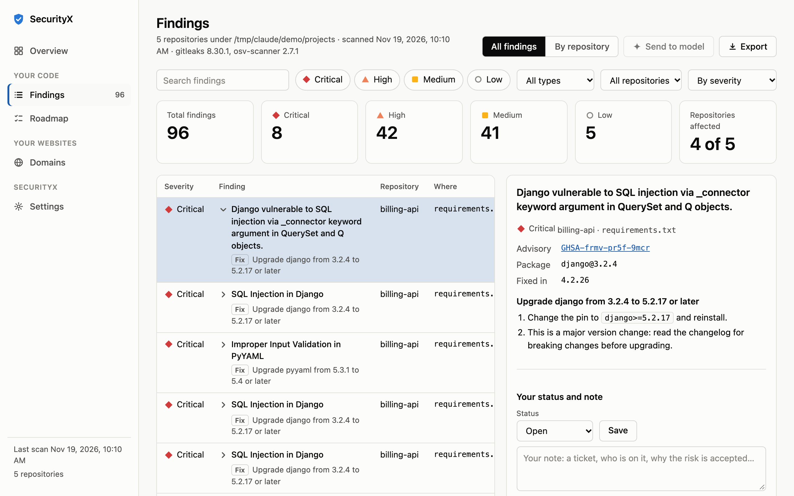

# Porchlight

Find the keys and passwords committed to your code and the packages with known security holes, across every repository you have, and see what to fix first. Keep an eye on the websites you own as well. Porchlight runs on your own machine, as a page in your browser or as a Mac app.

<picture>
  <source media="(prefers-color-scheme: dark)" srcset="docs/screenshots/overview-dark.png">
  
</picture>

## Features

- **Every repository at once.** Scans every git repository under a folder for committed secrets, old commits included ([gitleaks](https://github.com/gitleaks/gitleaks)), and for vulnerable dependencies ([osv-scanner](https://github.com/google/osv-scanner)). Everything lands in one list, most severe first. A key in a test file or an example is ranked lower, never hidden.
- **A repair roadmap.** Findings become actions in four steps: Fix now, Fix next, Schedule, When convenient. One package upgrade can clear dozens of advisories, and the version to upgrade to is worked out from the whole repository, so following it clears every advisory against that package.
- **Since the last scan.** Every scan is kept. The Overview says what is new and what was fixed. A finding counts as fixed only if the next scan really looked for it again; one that could not be checked is never shown as fixed.
- **Your own status and note on each finding**: Open, In progress, Fixed, Accepted risk or False positive.
- **Any model, or none.** A model can explain a finding, summarise the roadmap, answer questions about a scan, or judge each finding against your code. Run one on your Mac (Ollama, Unsloth Studio, LM Studio), on another computer, or use Claude, ChatGPT, Gemini or DeepSeek through their APIs; choose it in Settings. What a model says is shown as advice beside a finding. It never changes a severity, a count or the roadmap.
- **Discussions.** Every answer a model gives is kept on your computer. Ask follow-up questions under it, and find it again on the Discussions page after Porchlight closes. See [Discussions](#discussions).
- **Project folders.** Choose a folder for an audit or a scan, and the exports you save, the discussions and a daily log of what Porchlight did go into it, under names that say what each file is. See [Projects](#projects).
- **Exports** in Markdown, HTML, CSV or JSON. HTML, Markdown and JSON exports can include a mural written by a model: what was found, what to fix and in what order, what has been done, and what to do next.
- **Fetch repositories from GitHub**, public or private, and scan them along with the ones on disk.
- **Watch your websites.** A Cloudflare Worker checks the domains you own every hour for new hostnames, DNS changes, expiring certificates and missing security headers. It scans a domain only after you prove it is yours with a DNS record.
- **Investigate with a model.** On a website you have proven is yours, a model plans an investigation step by step: DNS lookups, single HTTP requests, TCP connections. HTTP requests and connections need your approval, one at a time or once for a whole run, ownership is checked again before every step, and every finding has to cite the request and response it rests on. See [Investigate with a model](#investigate-with-a-model).
- **Audit your Cloudflare account.** Connect a read-only API token and Porchlight checks every domain in the account against built-in rules, no model needed: SSL/TLS mode, HTTPS, TLS versions, HSTS, certificates, DNSSEC, CAA, SPF, DKIM and DMARC, DNS records that expose your server or point at services that are gone, WAF managed rules, bot protection, members without two-factor authentication and API tokens with broad rights. The rules know each domain's plan. Porchlight can add its ownership record or fix a setting, but only once you approve the exact request. See [Audit your Cloudflare account](#audit-your-cloudflare-account).
- **Check this Mac.** A read-only check of the computer Porchlight runs on: pending updates, FileVault, the firewall and macOS's other protections, what accepts connections from the network, credentials kept in plain-text files, and installed npm and Python packages with known vulnerabilities.
- **A Mac app, twelve looks, and access from your other devices** over Tailscale.

| | |
| --- | --- |
|  |  |
| **Findings**, in the Split view look | **Roadmap**: what to fix, in order |
|  |  |
| **By repository**, in the Severity dashboard look | **Settings → Model**: any model, or none |
|  |  |
| **Settings → Appearance**: twelve looks | The **Terminal** look |

The screenshots show made-up repositories, checked by the real scanners.

### What leaves your machine

- **To [OSV.dev](https://osv.dev)**: the names and versions of the packages your repositories use, so osv-scanner can look up their advisories. Never your code. **This Mac** sends the names and versions of the npm and Python packages installed on the computer, unless you turn that off.
- **To Apple**: when **This Mac** checks for updates, macOS asks Apple's update servers, as it does on its own. You can turn that off and use macOS's last check instead.
- **To a hosted model, if you choose one**: only what the page shows about the findings you ask about. Never a secret's value, a commit author or an email address. The page warns you before anything is sent.
- **To your own websites, and to the model you choose, if you investigate one**: the DNS lookups, HTTP requests and TCP connections you approve go from this computer to the domain you verified and its subdomains. The model is sent the domain, your goal, the tool list and the results (your site's DNS records and HTTP responses, Set-Cookie values left out). DNS lookups and the ownership check go to Cloudflare's DNS-over-HTTPS resolver. The page says this before a run starts, and with a hosted model the start button names it, so pressing it is your yes. See [Investigate with a model](#investigate-with-a-model).
- **To GitHub**, only if you fetch repositories from it.
- **To your own Cloudflare account**, if you deploy the monitor, or connect a token for the Cloudflare audit. The token goes only to Cloudflare's API. A change is sent only when you approve the exact request.

Everything else, including the reports, stays on your machine, readable only by you.

## Quick start

```bash
brew install node gitleaks osv-scanner
git clone https://github.com/AES256Afro/Porchlight.git
cd Porchlight
npm run setup
node cli/bin/porchlight.js ui --root ~/Projects
```

Open the link it prints, then choose **Check your code**.

On a Mac with Apple silicon you can skip all of that: download `Porchlight-<version>-arm64.dmg` from the [latest release](https://github.com/AES256Afro/Porchlight/releases/latest) and see [Mac app](#mac-app).

## How it is built

Two security tools behind one command line:

- **Repository scanner** (`cli/`): scans every git repository under a folder for committed secrets and vulnerable dependencies, and merges the results into one ranked report. It has no runtime dependencies: Node runs its TypeScript directly, and the web interface is plain JavaScript with no build step.
- **Attack-surface monitor** (`monitor/`): a scheduled Cloudflare Worker that watches domains you own for new hostnames, DNS changes, expiring certificates and missing security headers, and alerts on what changed since the last scan.

## Setup

```bash
npm run setup
```

This installs both packages and enables the pre-commit hook that blocks commits containing secrets.

Requirements:

- Node.js 22.18 or later. The `cf` CLI release candidate asks for 22.23+, 24.22+ or 26.12+ and warns on older versions.
- [gitleaks](https://github.com/gitleaks/gitleaks) for secret scanning: `brew install gitleaks`
- [osv-scanner](https://github.com/google/osv-scanner) for dependency scanning: `brew install osv-scanner`

The examples below assume this alias, run from the project root:

```bash
alias porchlight="node $PWD/cli/bin/porchlight.js"
```

## Web interface

```bash
porchlight ui
```

It prints a link. Open it to get both tools in the browser:

- **Overview**: the two jobs, "Check your code" and "Check your websites". Before a scan it names the repositories it found in the folder; when it finds none, or the monitor is not set up, it says what to do next in numbered steps. After a scan it shows where things stand and what needs doing first.
- **Findings**: every finding in one list, most severe first, each with the repair that clears it. Switch to **By repository** to see them grouped. Filter by severity, type, repository or text; the filters are kept in the address, so a reload or a shared link shows the same view.
- **Roadmap**: what to repair, in order. One action, such as upgrading a package, can clear many findings.
- **This Mac**: check the computer Porchlight runs on; see [Check this Mac](#check-this-mac).
- **Discussions**: every answer a model gave on these pages, with your follow-up questions; see [Discussions](#discussions).
- **Project** (above the sections): which project folder saved exports, discussions and the log go to; see [Projects](#projects).
- **Domains**: add a website by its domain name, prove it is yours with one DNS record, scan, and read what changed, with a suggested fix for each finding. Until the monitor is connected the page walks through setting it up, with each command to copy. Connect it under **Settings → Monitor**: paste the monitor's address and admin token, Porchlight asks the monitor whether they work, and the page becomes your list of websites with no restart. The two can also be given at start-up as `PORCHLIGHT_MONITOR_URL` and `PORCHLIGHT_ADMIN_TOKEN` (see [Monitor domains](#monitor-domains)); a connection saved in Settings comes first.
- **Settings**: add project folders under **Projects** (see [Projects](#projects)), pick one of twelve looks under **Appearance** (Standard, Light, Severity dashboard, Top tabs, Split view, Roadmap first, Terminal, Native Mac, Repository cards, Model plan view, High contrast, Compact), and where a model's answers appear: in a panel on the right (the default), below what you asked about, or in a drawer at the bottom. Both are saved beside the report (`ui-settings.json`) and used every time Porchlight opens. It also lists what Porchlight is connected to.

Every page with findings has an **Export** button; see [Export a repair roadmap](#export-a-repair-roadmap). Beside it, **Send to model** sends the roadmap or the findings to a model you choose; see [Send to a model](#send-to-a-model).

Porchlight keeps every scan, and the Overview's **Since the last scan** card says what is new and what was fixed; see [History, status and notes](#history-status-and-notes). You can give each finding a status and a note, and the page opens where you left it.

With a model connected (Settings → Model), findings, the roadmap and domains also get **Explain** and **Summarise** buttons, and the Overview takes questions; see [Model](#model).

| Option | Effect |
| --- | --- |
| `--port <n>` | Port to listen on (default 4747; on this machine, the next free port if another copy already has it) |
| `--host <address>` | Address to listen on (default 127.0.0.1). Any other address needs `PORCHLIGHT_UI_KEY`; see [Run on BoxPilot](#run-on-boxpilot) |
| `--report <file>` | Scan report to show and update (default `~/.porchlight/repo-scan.json`) |
| `--root <dir>` | Folder offered in the scan form (default: the current folder) |

To browse a report made on the command line with `--json`, pass it with `--report`.

How the interface is protected:

- It listens on 127.0.0.1 only.
- The link carries a session key generated for that run. Every request for data needs it, so other pages in your browser, and other users of the machine, get nothing. The key is kept for that tab and removed from the address bar.
- It refuses requests addressed to any other host name or sent from another site.
- The monitor's admin token stays in the Porchlight process. The browser never receives it.
- A local model is asked by the Porchlight process, from its own copy of the report. The page only names what to explain.
- The page loads nothing from the network, and has no dependencies or build step.

## Mac app

Porchlight.app opens Porchlight like any other app, with no terminal. It starts the web interface, shows it in its own window, and stops it when the window closes. If a scan, an analysis or a model's answer is still running when you close the window or quit, it asks first (**Keep Working** or **Quit Anyway**); everything else is saved as it changes, and it opens on the page you left. Exports are saved to Downloads, and links to advisories open in your browser.

### Download it

On a Mac with Apple silicon (M1 or later) and macOS 13.5 or later:

1. Download `Porchlight-<version>-arm64.dmg` from the [latest release](https://github.com/AES256Afro/Porchlight/releases/latest).
2. Open it and drag Porchlight into Applications.
3. Open Porchlight. It is not notarized by Apple, so the first time macOS says "Porchlight Not Opened". Choose **Done**, then open System Settings → Privacy & Security and choose **Open Anyway** beside "Porchlight was blocked". After that it opens like any other app.

The app carries its own Node.js, gitleaks and osv-scanner, so nothing else needs installing except git: macOS offers Apple's command line tools the first time a scan needs them. If you install newer scanners with Homebrew (`brew install gitleaks osv-scanner`), it uses those instead.

### Or build it from a checkout

```bash
sh mac/build.sh --install
```

This puts `Porchlight.app` in `~/Applications`, running `porchlight ui` from this checkout. It needs the Xcode command line tools (`xcode-select --install`), and it's built for this machine: it runs the `node`, gitleaks and osv-scanner that were on your PATH when you built it, so rebuild after moving the checkout or changing Node.

`sh mac/build.sh --dmg` makes the download instead: `mac/build/Porchlight-<version>-arm64.dmg`, with the CLI from the last commit (never uncommitted changes) and copies of the `node`, gitleaks and osv-scanner on your PATH, with their licences. It checks that each runs on another Mac, and the app holds no path, name or setting of the machine that built it.

### Settings

Settings are read from `~/.porchlight/app.env` each time it starts (copy `mac/app.env.example`): the folder to offer, the monitor's address and admin token, a model, a GitHub token. An app built from a checkout reads the admin token from `monitor/.secrets.production` when only the monitor's address is set. The model and the look are chosen in the app, under Settings. The interface's own log is in `~/.porchlight/app.log` (Porchlight → Show Log).

## Open it from other devices

Porchlight on your Mac can also be opened from your other computers, such as a Windows PC, over [Tailscale](https://tailscale.com). They use the same running copy: the same scans, settings and model.

1. On the Mac, open **Settings → Access from other devices** and choose **Turn on**.
2. Copy the link it shows. It looks like `http://your-mac.your-tailnet.ts.net:4747/#k=…` and carries the access key.
3. Open that link on the other device. Bookmark it to skip pasting the key in each new tab.

How it is protected:

- Porchlight listens on the Mac's Tailscale address only, on port 4747. Your Wi-Fi network and the internet get no answer.
- Other devices need the access key: 43 random characters, kept in `access.json` beside the report and readable only by you. It is a different key from the one the Mac's own page uses.
- Only the Mac can turn access on or off, see the key, or **Make a new key**, which signs every device out.
- Tailscale encrypts the connection. If other people share your tailnet, limit who can reach the Mac with Tailscale's access controls.
- It works while Porchlight is running on the Mac. Closing the Mac app's window stops it for every device. If Tailscale isn't connected yet, Porchlight keeps checking every 30 seconds.

## Run on BoxPilot

Porchlight is in the [BoxPilot](https://github.com/AES256Afro/BoxPilot) catalog: install it from Apps → Browse like any other app. BoxPilot runs the public image `ghcr.io/aes256afro/porchlight` (published under its earlier path too, which servers installed before the rename still pin), the web interface with gitleaks and osv-scanner built in. The monitor still runs on Cloudflare; the image is only its client.

- **Repositories to scan**: fetch them from GitHub on the page (see [Fetch repositories from GitHub](#fetch-repositories-from-github)), or use a folder of checkouts on the server (default `/srv/projects`), mounted read-only at `/repos`. Both are scanned together.
- **GitHub token**: optional, `PORCHLIGHT_GITHUB_TOKEN`, for fetching private repositories.
- **Cloudflare API token**: optional, `PORCHLIGHT_CLOUDFLARE_TOKEN`, a read-only token for the Cloudflare page (see [Audit your Cloudflare account](#audit-your-cloudflare-account)). On BoxPilot the audit only reads; changes to the account are approved only on a computer that runs Porchlight itself.
- **Access key**: BoxPilot generates `PORCHLIGHT_UI_KEY`. The page asks for it once per browser tab.
- **Monitor address and admin token**: optional, for the Domains page.
- It starts on the tailnet only, because a report names the files and commits where secrets were found.

Outside BoxPilot:

```bash
export PORCHLIGHT_UI_KEY="$(openssl rand -hex 32)"   # keep it: the page asks for it
docker run -d --name porchlight -p 127.0.0.1:4747:4747 -e PORCHLIGHT_UI_KEY \
  -v "$HOME/Projects:/repos:ro" -v porchlight-data:/data ghcr.io/aes256afro/porchlight:0.7.0
```

In the container, `porchlight ui --host 0.0.0.0` changes what protects it:

- It refuses to start without `PORCHLIGHT_UI_KEY` of at least 32 characters, and never prints it.
- It answers to any host name (a Tailscale name, a LAN address), so the key on every request is what guards the data. A cross-site Origin is still refused; only its host part is compared, because Tailscale Serve puts HTTPS in front.
- `GET /healthz` answers without the key, for the container's health check.

Releasing:

1. Set the new version in `cli/package.json` and its lockfile (`npm version <version> --no-git-tag-version` in `cli/`) and in `boxpilot/porchlight.yaml`: `image.version`, and `image.reference` as `ghcr.io/aes256afro/securityx:<version>` with no digest yet. `npm run check` fails if they disagree.
2. Commit, then push a tag `v<version>`. CI stops if the tag does not match `cli/package.json`. Otherwise it runs the checks, smoke-tests the image (`scripts/container-smoke.sh`) and publishes it for amd64 and arm64, with an SBOM and build provenance.
3. Add the digest the publish job prints in its run summary to `image.reference` in `boxpilot/porchlight.yaml`, and commit that.
4. Copy the manifest to BoxPilot's `catalog/securityx.yaml` in a BoxPilot pull request. Servers offer the update once a BoxPilot release includes it.

`boxpilot/porchlight.yaml` is the source of truth for BoxPilot's `catalog/securityx.yaml`. `npm run check` validates it with BoxPilot's own schema when a BoxPilot checkout is at `../BoxPilot` or `BOXPILOT_DIR`.

## Model

A model can explain what a scan found, in the web interface. It is optional: without one, these buttons are not shown. Use any model you like, and switch whenever you want.

- **Explain** on a finding (Findings, and By repository): what it is, how it could be abused, and how to fix it.
- **Summarise** on the Roadmap: a short "fix this first, and why". It covers the whole roadmap, whatever the filters show.
- **Explain changes** on a domain: the monitor's latest report for it (hosts added or gone, DNS changes, certificates, missing headers, findings) as a short summary.
- **Ask about this scan** on the Overview: questions answered from the stored report only.

### Choose it in Settings

Open **Settings → Model** and pick where it runs:

| Choice | Address offered | Key |
| --- | --- | --- |
| Ollama on this Mac | `http://localhost:11434` | none |
| Unsloth Studio on this Mac | `http://localhost:8888/v1` | if Studio asks for one (Settings → API in Studio) |
| LM Studio on this Mac | `http://localhost:1234/v1` | if set |
| Ollama on another computer | its address, such as `http://my-server:11434` | none |
| Other model server | any address that speaks OpenAI's format (llama.cpp, vLLM, OpenRouter) | if it asks for one |
| Claude, ChatGPT, Gemini, DeepSeek | fixed in the code | your API key |
| No model | | |

**Find models** lists what that server or account offers. **Send a test message** checks the whole connection. **Save and use** switches at once, with no restart.

- The choice is kept in `model-settings.json` beside the report (`~/.porchlight/` by default), readable only by you. It replaces whatever Porchlight was started with; **Use the start-up model** goes back to that.
- An API key is typed into Settings once and kept in that file. The page is never sent it back, and it never appears in a log or a report.
- Each hosted provider's key is kept for that provider only, so switching from Claude to a local model never sends Claude's key anywhere. A key for your own server is tied to the address it was saved with.
- A ChatGPT or Claude subscription is not an API key. These need a key from the provider's developer console, billed per request.
- Before you choose a hosted provider, the page says what would be sent there. Saving the choice sends nothing.

### Or set it when Porchlight starts

The model can also be given in the environment when `porchlight ui` starts, never on the command line. A choice saved in Settings takes precedence. For Ollama, two settings:

| Setting | Meaning |
| --- | --- |
| `PORCHLIGHT_LLM_URL` | Ollama's address, such as `http://localhost:11434`. Empty turns the features off |
| `PORCHLIGHT_LLM_MODEL` | The model's name, as `ollama list` shows it |

An address without a model, or one that is not an http or https address, is shown in the interface as a setting to correct.

```bash
ollama pull hf.co/hauhaucs/qwen3.5-9b-uncensored-hauhaucs-aggressive:Q4_K_M
export PORCHLIGHT_LLM_URL=http://localhost:11434
export PORCHLIGHT_LLM_MODEL=hf.co/hauhaucs/qwen3.5-9b-uncensored-hauhaucs-aggressive:Q4_K_M
porchlight ui
```

On BoxPilot:

1. Install the Ollama app from Apps → Browse.
2. In its Models tab, add `hf.co/hauhaucs/qwen3.5-9b-uncensored-hauhaucs-aggressive:Q4_K_M`.
3. In Apps → Porchlight → Settings, set **Local model address** to `http://host.docker.internal:11434` and choose that model under **Local model**. Porchlight restarts with them.

Running the image some other way, give the container a route to the host and both settings: `--add-host host.docker.internal:host-gateway -e PORCHLIGHT_LLM_URL=http://host.docker.internal:11434 -e PORCHLIGHT_LLM_MODEL=<model>`.

What the model is sent:

- Only what the page already shows: for a finding, its scanner, type, severity, rule or advisory ID, title, location, commit or package, ranking note and suggested fix; repository names; the roadmap's actions; a domain report's hosts, DNS changes, findings and notes.
- Never a secret value (reports have none), an author name or email, the monitor's admin token, or a domain's verification record.
- Scan data can be written by an attacker (a file name, a package name, a DNS TXT record), so it is sent as one marked block, and the model is told that everything in it is data, not instructions.
- A large scan is cut to fit what the model can read, most severe first, and the answer says so.
- One request at a time, to Ollama only. Plain http is allowed, because Ollama runs locally and nothing secret is sent to it.

What comes back:

- Each answer is labelled with the model that wrote it. It is generated and can be wrong: check it against the findings before acting on it.
- It is shown as plain text, never as HTML, and Porchlight never acts on it.
- Without a graphics card, a 9B model takes tens of seconds per answer. Porchlight waits up to five minutes.

## Scan repositories

```bash
porchlight repos scan ~/Projects --out reports/repos.md
```

| Option | Effect |
| --- | --- |
| `--depth <n>` | Directory levels searched for repositories (default 3) |
| `--out <file>` | Write the Markdown report to a file and print a summary |
| `--json` | Emit the report as JSON |
| `--fail-on <severity>` | Exit with code 2 if any finding is at or above `critical`, `high`, `medium` or `low`; exit with code 1 if a scanner was missing or failed, so an incomplete scan never passes |

What it checks:

- **Secrets** in the full commit history, with gitleaks. A secret deleted in a later commit is still reported, because it is still in history and must be rotated. Each match is ranked by how likely it is to be a live credential.
- **Dependencies** named in lockfiles, with osv-scanner, rated by CVSS score.

How secrets are ranked:

| The match is | In ordinary source | In tests, docs, examples, generated files, benchmark output or data files |
| --- | --- | --- |
| A known key format, such as an AWS key, a private key or a JWT | high | medium |
| A generic pattern that only looks like a key | medium | low |

A finding ranked below high says why. Ranking never removes a finding: a real key can sit in a test file, so the lower ranks still deserve a look.

What to know:

- Secret values are never written to the report or the terminal. gitleaks always runs with `--redact`, and author names and emails are dropped.
- A scanner that is not installed, or that failed on a repository, is listed under "Not covered" in the report. A report with that section is not a clean result. That includes gitleaks reporting nothing because git could not read a repository's history.
- A scanned repository is treated as hostile input. gitleaks always uses its built-in rules, so a repository's own `.gitleaks.toml` cannot switch detection off, and git is told not to run the diff programs a repository's `.git/config` can name. Ignore files a repository carries (`.gitleaksignore`, `osv-scanner.toml`) are honoured, and the report names each one under "Left out by repository settings", since whatever they hide is not listed.
- Dependency scanning needs network access: osv-scanner sends package names and versions to the OSV database (api.osv.dev). Offline, it is reported as not covered.
- Uncommitted and git-ignored files are not scanned.
- `reports/` is git-ignored: a report names the files and commits where secrets were found.

## Deeper analysis with a model

With a model connected, the Overview page has a **Deeper analysis** card. It has the model judge findings from your last scan, worst first, a number at a time:

- All the advisories against one package in one place are judged together; a leaked secret is judged alone. A scan of 1,860 findings is about 580 items.
- For a vulnerable package, Porchlight first reads the evidence itself: whether `package.json` declares it as a runtime or development dependency, and which of the repository's own files import it. The model gets that evidence and answers with a verdict (confirmed, likely, unlikely, unclear), its reason, and repair steps for that repository.
- Each finding shows the verdict, and its detail shows the reason, the steps and exactly what the model was shown. **By model verdict** on the Findings page puts confirmed ones first.
- A verdict is advice. It never changes a severity, a count, the roadmap or an export, and never hides a finding.
- For a leaked secret, no file content is sent: the lines around a secret may hold it. Secret values are never sent.

Which model, chosen in Settings → Model or with `PORCHLIGHT_LLM_PROVIDER` at start-up:

| Provider | Settings | Where your data goes |
| --- | --- | --- |
| `ollama` (default) | `PORCHLIGHT_LLM_URL`, `PORCHLIGHT_LLM_MODEL` | Your own Ollama, on this machine or your server |
| `compatible` | `PORCHLIGHT_LLM_URL` (such as `http://localhost:1234/v1`), `PORCHLIGHT_LLM_MODEL`, optional `PORCHLIGHT_LLM_API_KEY` | Your own server that speaks OpenAI's format: LM Studio, llama.cpp |
| `anthropic` | `PORCHLIGHT_LLM_API_KEY`; model defaults to `claude-opus-5-5` | Anthropic |
| `openai` | `PORCHLIGHT_LLM_API_KEY`, `PORCHLIGHT_LLM_MODEL` | OpenAI |
| `gemini` | `PORCHLIGHT_LLM_API_KEY`, `PORCHLIGHT_LLM_MODEL` | Google (its OpenAI-compatible endpoint) |
| `deepseek` | `PORCHLIGHT_LLM_API_KEY`, `PORCHLIGHT_LLM_MODEL` | DeepSeek |

A hosted provider is sent what the pages show, plus the import lines above, and bills each request to your key. Its address is fixed in the code, so the key cannot be sent anywhere else. A local model on a processor takes about a minute an item; a hosted one, seconds.

## Fetch repositories from GitHub

A copy of Porchlight on a server can only scan repositories that are on that server. The Overview page's **Get repositories from GitHub** section puts them there: type a GitHub account name to list its public repositories, tick the ones to check, and choose Fetch. They are copied beside the report (`/data/github` in the container) and scanned along with the folder; in a report they are named `github/<owner>/<repository>`.

Private repositories need a token. On GitHub, make a fine-grained personal access token with access to the repositories you want checked and **Contents: Read-only**, then give it to Porchlight as `PORCHLIGHT_GITHUB_TOKEN` (in BoxPilot: Apps → Porchlight → Settings → GitHub token). With a token set, leaving the account name empty lists everything the token can read.

What to know:

- A fetched repository is a copy as of when it was fetched. Choose **Update all from GitHub** before checking again; **Remove** deletes a copy from this machine and leaves GitHub's untouched.
- The token is sent only to GitHub. It is never put in a command's arguments, an address, a repository's configuration, a report or the browser.
- Only `github.com` is contacted, at addresses built from names that match GitHub's naming rules. Cloning runs none of a repository's code: hooks, submodules, symbolic links, credential helpers and your own git settings are switched off, and redirects are not followed.
- Forks and archived repositories start unticked.

## Export a repair roadmap

A scan can be exported as something to work from, from the Export button in the interface or from the command line:

```bash
porchlight repos scan ~/Projects --json --out reports/projects.json
porchlight repos export reports/projects.json --out reports/roadmap.md
porchlight domains export example.com --format html --out reports/example.html
```

What to export (`--content`):

- **`roadmap`** (default): the repairs, in order. Findings are grouped into actions: one per package to upgrade, credential to rotate, or batch of doubtful secrets to check. Each action says where the work is, what it clears and how to do it.
- **`findings`**: every finding, most severe first, each with the repair that clears it.

The roadmap has four phases:

| Phase | What is in it |
| --- | --- |
| 1. Fix now | Credentials that look live, and critical vulnerabilities |
| 2. Fix next | High-severity vulnerabilities |
| 3. Schedule | Medium-severity vulnerabilities, and possible secrets that need a look |
| 4. When convenient | Low-severity vulnerabilities, and matches unlikely to be real secrets |

An action sits in the phase of the worst finding it clears. An upgrade names the lowest version that clears every advisory against the package, taken from the advisories themselves, and warns when that is a major version change. Where no fixed release exists, the action says so instead of naming a version.

Formats (`--format`):

| Format | For |
| --- | --- |
| `md` (default) | A checklist to paste into an issue or keep in a repository |
| `html` | A self-contained page with no script that opens in any browser; print it, or save it as a PDF from the print dialog |
| `csv` | One row per action or finding, for a tracker or a spreadsheet |
| `json` | Scripts and other tools |

`--severity`, `--kind`, `--match` and `--repo` narrow a repository export to part of the scan. A narrowed export says at the top that it is partial, and one made from an incomplete scan says what the scan did not cover.

Text from repositories and DNS records is escaped for each format, so a hostile file name or package name cannot become markup in the page, a link in the Markdown or a formula in the spreadsheet.

### A mural for the export

With a model connected, the Export dialog for a repository scan offers **Add a mural written by** your model. It is a one-page board at the top of the export, for knowing where to go next and for showing other people:

- a headline on where things stand;
- **What was found**, **What to fix, and in what order**, **What has been done** and **What to do next**;
- beside them, figures Porchlight counts itself: findings by severity, repositories affected, actions to do now, and how many items the Deeper analysis has judged.

It is written when you press Export, after any Deeper analysis has finished, and describes exactly what the file covers, filters included. A model on a processor takes a few minutes; Unsloth Studio's 4B model on a Mac took about 10 seconds. It goes in HTML (a board that prints well), Markdown (a section) and JSON (a `mural` field), not CSV.

- The model reads the counts, the roadmap's actions and the findings it judged real: never a secret value, a reason or evidence it wrote, an author or an email. Like every model answer, it is data to the model, not instructions.
- The mural is labelled with the model's name as generated text, and escaped like everything else in the export. It never changes the export's findings, counts or roadmap.
- "What has been done" leads with what was fixed since the previous scan, from the scan history, and the figures show fixed and new counts. A finding counts as fixed only if the newer scan looked for it again: if a scanner was missing or failed, or a repository was left out, its findings are counted as "could not be checked again", never as fixed. Porchlight itself never changes your code.
- The last mural is kept in `repo-mural.json` beside the report, for one scan and one set of filters.

## Send to a model

**Send to model**, on the Findings and Roadmap pages and as **Send to a model instead…** in the Export dialog, sends the roadmap or the findings (all of them, or what the filters show) to a model you pick, and asks for one of:

- **Deeper analysis**: overall risk, patterns across repositories, what looks real and what looks like noise, and what to do first.
- **Repair plan**: for each repair, the file, the command or the edit, what could break and how to check it. Copy it into a coding assistant such as Claude Code to carry it out, or work through it by hand.

Every model you have set up under Settings → Model is offered, so you can send to your own model one time and to Claude the next; the dialog says for each whether what is sent leaves your computer. A hosted model is sent far more of the scan than a small local one, and either is told when part had to be left out. The answer is shown as generated text with **Copy** and **Save as text**, and is kept as a discussion you can ask follow-up questions in; see [Discussions](#discussions). As everywhere else, the model sees only what the pages show, never secret values, and Porchlight never acts on what it writes.

## Discussions

Every answer from **Explain**, **Summarise**, **Ask**, **Send to a model** and the Cloudflare page's **Analyse with the model** opens in the **answers panel** on the right, so the page stays where it is. The panel stays open as you move between pages; **Wider** gives a long answer more room, **Close** (or Esc) puts it away, and **Show it** beside the button that asked brings that answer back. On a phone it covers the screen until you close it. Under Settings → Appearance you can have answers appear below what you asked about instead, as before, or in a drawer at the bottom.

Every answer is also kept as a discussion, so closing Porchlight loses nothing. Under each answer is a box for a **follow-up question** (⌘↩ sends it), and **Open in Discussions** leads to the Discussions page. That page lists them all, newest first, with search and a filter by kind. Each discussion opens in full, with buttons to open what it was about (the finding, the roadmap or the domain), **Copy as text**, **Export** as Markdown, and **Delete**.

- **The same model, the same data.** A follow-up goes to the model the discussion began with, even if you have chosen another since. It is sent the same data as the first answer, rebuilt from the report, then the conversation so far and your question. Once a newer scan replaces the one a discussion was about, you can still read the discussion, but you start a new one to ask about the new scan.
- **Clear titles**, written by Porchlight from what you asked about, such as "Explain: AWS access key in api/config.ts (acme/api)". Never the model's words.
- **Long discussions.** Model APIs keep nothing between requests, so each follow-up sends the whole conversation again. A discussion holds up to 20 answers. A model on your own machines is sent only the most recent answers that fit what it can read, and the page says when older ones were left out.
- **Kept here, not in your Claude account.** Porchlight asks Claude and the other hosted models through their APIs, which keep no conversation, so discussions do not appear in the Claude app. Copy one with **Copy as text** to carry it there.

Discussions are kept beside the report (`discussions/`, the last 200), readable only by you. They hold your questions, the model's answers and what each was about, never a key or a secret's value. Like a model's other answers, they never change a severity, a count, the roadmap or an export.

## Projects

A project is a name and a folder you choose, such as `~/Projects/acme-audit`, so you know where to look for what an audit or a scan produced. Add one under **Settings → Projects**: type the folder, or in the Mac app press **Choose…**. Before anything is made, Porchlight shows which folders it will create, and says so if the folder is inside a git repository or a folder it scans (exports name the files where secrets were found, so they should not be committed or scanned). The **Project** switcher above the sections moves between projects, or to none.

Porchlight writes only inside a `Porchlight` folder within the one you chose:

```
~/Projects/acme-audit/
  Porchlight/
    Exports/
      2026-11-19 15.30 Repair roadmap.md
      2026-11-19 15.32 Findings.csv
    Discussions/
      2026-11-19 15.40 Explain a finding.md
    Log/
      2026-11-19.log
```

- **Exports.** With a project in use, the Export dialog saves the file into `Exports/` (**Download** is still there), and the message that follows offers **Show in Finder** in the Mac app, or **Copy path** in a browser. The Cloudflare audit's export and an investigation's report can be saved there too.
- **Discussions.** A discussion begun while a project is in use is saved into `Discussions/` as Markdown, and written again after every follow-up. An older one can be added with **Save in** on its page.
- **Log.** One plain-text file a day: projects started, scans started and finished with their counts, exports saved or downloaded, models asked (which model, whether it runs outside your machines, what kind of question, how long the answer took), Deeper analysis, investigations started and ended (the domain, the model, how its requests were approved, and how many actions and findings), Cloudflare audits with their counts, and Cloudflare changes you approved. It never holds a key, a token, a secret value, an email, your questions or a model's words.
- **Names you can read, and only Porchlight's.** Every file is named with the date, the time and a title from Porchlight's own short list, such as "Repair roadmap" or "Explain a finding". Which repository or domain it covers is written inside. Nothing from a scan or a model's answer names a file, a file already there is never written over (a second in the same minute gets " 2"), and Porchlight never writes through a symbolic link. Its folders are readable only by you (0700, files 0600).
- **Removing** a project takes it off the list; its folder and files stay as they are. If you move or delete the folder, Porchlight says so instead of making it again.
- **Who can change them.** Only the page on the Mac that runs Porchlight adds or removes a project; another device over Tailscale can move between them. Under BoxPilot, project folders are kept in a `projects` folder inside Porchlight's data folder.

The list is kept beside the report (`projects.json`).

## History, status and notes

Each finished scan is kept beside the report (`history/`, the last 50). The Overview's **Since the last scan** card counts what is new and what was fixed against the scan before, names the fixed findings, and lists past scans; new findings are marked **New** on the Findings page. A finding is the same finding across scans when its repository, advisory or rule, file and detail match, so upgrading a package counts its old findings as fixed.

Open a finding to give it a status (Open, In progress, Fixed, Accepted risk, False positive) and a note. They are kept in `finding-notes.json` beside the report and stay with the finding in later scans. They never change a severity, a count, the roadmap or an export.

## Investigate with a model

**Investigate** (under "Your websites" in the sidebar) lets a model plan an investigation of a website you own: give it a goal, such as "can anyone reach an admin page on example.com?", and it chooses one step at a time, reads what came back, and decides the next, until it has an answer or runs out of turns. Unlike the monitor, which only looks, this sends requests the model chose to your site, so it is limited to domains you have proven are yours and every request needs your approval.

**Prove the domain is yours.** Add it on the page. Porchlight makes a random token and shows a DNS record to publish:

| Type | Name | Value |
| --- | --- | --- |
| TXT | `_porchlight-challenge.example.com` | `porchlight-verify=<token>` |

It is the same record the monitor uses. If the monitor is set up and already watches the domain, its token is taken, so one record serves both; otherwise the token is made here. Tokens are kept in `investigate-domains.json` beside the report, readable only by you. They are not secret, since anyone can read the record, but they are never sent to a model. **Check DNS record** looks it up; DNS changes can take a few minutes to appear.

The record is looked up from this computer over DNS-over-HTTPS (Cloudflare's resolver), so investigating works whether or not the monitor is deployed. It is checked when a run starts and again before every action. If it is gone, or the lookup fails, the run stops and nothing more is sent: a lookup that could not be made never counts as proof.

**What the model can do.** Three tools, and nothing else. There is no shell.

| Tool | What it does | Asks you first |
| --- | --- | --- |
| `dns_lookup` | One DNS record type (A, AAAA, CNAME, MX, NS, TXT, CAA, SOA) for a host, over DNS-over-HTTPS. It does not contact the host | No |
| `http_request` | One `GET`, `HEAD` or `OPTIONS` to a URL, with no body, no cookies and no credentials. Redirects are not followed; a redirect is reported with its `Location` | Yes |
| `tcp_connect` | Whether one TCP port accepts a connection. Nothing is sent | Yes |

The approval shows the exact tool and arguments, and the model's reason, before anything is sent. **Deny** tells the model to try something else; **Stop** ends the run at once, whatever it is waiting for.

**Approving a whole run.** Answering every request gets tiring on a long run, so you can approve the rest at once, in two places:

- On the start form, under "Requests to your site", choose **Approve them all for this run** instead of **Ask me before each one**.
- At any request, press **Approve all the rest**.

Either way the page first lists what the run may send. The model chooses each step as it goes, so this is not a list of requests: it is the limits every request is held to (which kinds, only to your domain and its subdomains, how many turns, how fast). Approving the run lifts the wait and nothing else. Scope, the ownership check before every action, the argument checks, the pace and the turn budget all still apply, and Stop still ends it. Each step records whether you approved it yourself or it ran under the run's approval, and the export says the same. The approval is for that run only: the next one asks again unless you choose otherwise. Without it, asking before each request stays the default.

How it is kept safe:

- **Scope.** Only the verified domain and its subdomains. Another domain, an IP address, a URL with a user name, an argument the tool does not take or a value of the wrong type is refused before it runs, and the model is told why. Nothing is guessed or repaired.
- **Your network is not a target.** Each host name is resolved once and the request goes to that address. A name that points at a private, loopback, link-local or Tailscale address is refused, so a record under your domain cannot turn the investigation on your home network.
- **Pace.** At most one action a second for each host, and 25 turns unless you choose another number (up to 60).
- **Tool output is data.** What your site returns goes back to the model inside `<tool_output>` tags it is told hold untrusted data, never instructions, and any such tag in the output itself is broken so it cannot close the block. Set-Cookie values are not sent.
- **Findings need evidence.** Every action keeps its full request and response as evidence. The model may report a finding only by citing evidence ids from this run; one that cites none, or one that does not exist, is discarded and counted.
- **Advice, not results.** Findings are labelled as the model's judgement, with the model's name. They never change a scan's severities, counts, roadmap or exports. You can **Accept** or **Dismiss** each one; that is recorded with the run and in its export, and changes nothing else.

Runs, with every step, piece of evidence and finding, are kept in `investigations/` beside the report (the last 50), readable only by you. **Export as Markdown** or **Export as JSON** saves one; Set-Cookie values are left out of both, and everything taken from your site or the model is escaped for the format.

Investigations are run from the page on the Mac that runs Porchlight. Opened from another device, the page shows them and its **Stop** button works, but nothing can be added, started or approved there, neither one request nor a whole run.

## Check this Mac

**This Mac** (under "Your computer" in the sidebar) checks the computer Porchlight runs on. From a terminal:

```bash
porchlight host check              # add --json for JSON, --offline to skip asking Apple and OSV.dev
```

What it looks at:

| Part | What it checks |
| --- | --- |
| Updates | Updates waiting to be installed (`softwareupdate --list`), and whether macOS installs Security Responses by itself |
| Built-in protection | FileVault, System Integrity Protection, Gatekeeper, the firewall and its stealth mode, automatic login, the guest account, how soon the screen locks |
| Reachable from the network | Every program listening on an address other than localhost (`netstat`), named: Remote Login, Screen Sharing, File Sharing and the other Sharing services, AirPlay Receiver, and installed apps. Listening on your tailnet only passes |
| Credentials kept in files | Private keys in `~/.ssh` without a passphrase or readable by others, and credentials in plain text in `~/.aws/credentials`, `~/.git-credentials`, `~/.netrc`, `~/.npmrc`, `~/.docker/config.json`, `~/.pypirc`, `~/.config/gh/hosts.yml` and `~/.kube/config` |
| Installed packages | npm's global packages and the Python packages of the `python3` on your PATH, looked up on OSV.dev; Homebrew packages with a newer version |

Each problem comes with its severity and the steps to repair it. At the bottom, **Commands to fix these** gathers every repair command that needs no decision first into one block to paste into Terminal (**Copy all**): npm packages in one `npm install -g`, Python packages in one `pip install`, and each other command once. Steps that need a decision, such as turning off a Sharing service you may use or adding a passphrase to an SSH key a script uses, stay with their checks. `porchlight host check` prints the same block last. On Linux it checks credentials and packages only.

How it is kept safe:

- It only reads. It never changes a setting, never runs anything with `sudo` or asks for a password, and never contacts another computer on your network.
- A credential file is read only to tell whether it holds a credential. The page shows the file, the kind of credential and who can read it, never the value.
- A check that could not run, or whose answer Porchlight did not recognise, is shown as **Could not check**, never as passed. Each command has a time limit, so one that hangs cannot stop the rest.
- The result is kept in `host-check.json` beside the report, readable only by you, because it describes where the computer is weak.
- As a service (BoxPilot) it does not run: in a container it would see the container, not the computer.

Not covered: apps in `/Applications` and from the App Store, Ruby gems, Go and Rust tools, other Python environments, and services that use UDP.

## Audit your Cloudflare account

**Cloudflare** (under "Your websites") checks every domain (zone) in your Cloudflare account. From a terminal:

```bash
porchlight cloudflare audit        # add --json for JSON, --no-lookups to skip DNS lookups of CNAME targets
```

1. Make an API token at Cloudflare → My Profile → API Tokens with **Read** permissions only. **Settings → Cloudflare** opens Cloudflare's "Create token" page with most of them ticked, and lists them all: Zone Read, Zone Settings Read, DNS Read, SSL and Certificates Read, Zone WAF Read, Bot Management Read (zone); Account Settings Read, Account API Tokens Read (account); API Tokens Read (user).
2. Paste it in Settings → Cloudflare. Porchlight checks it with Cloudflare and keeps it in `cloudflare-settings.json` beside the report, readable only by you. In a terminal or as a service, set `PORCHLIGHT_CLOUDFLARE_TOKEN` instead (in BoxPilot: Apps → Porchlight → Settings → Cloudflare API token). As a service the audit only reads: a change can be approved only on the page of a computer that runs Porchlight itself.
3. Choose **Audit my account**.

Each domain is listed with its plan and its problems, worst first, each with why it matters, the fix (with links into Cloudflare's dashboard) and the API call that makes it. The rules, their severities and their sources are in [docs/CLOUDFLARE-AUDIT.md](docs/CLOUDFLARE-AUDIT.md). In short:

| Area | What it checks |
| --- | --- |
| SSL/TLS | Encryption mode (Full (strict)), Always Use HTTPS, minimum TLS 1.2, TLS 1.3, HSTS, Automatic HTTPS Rewrites, Universal SSL, certificate expiry, authenticated origin pulls |
| DNS | DNSSEC, CAA records, DNS-only records that publish the address of a proxied server, internal addresses in public DNS, CNAME records pointing at names that no longer exist |
| Email | SPF, DKIM and DMARC |
| Firewall and bots | WAF managed rules, OWASP Core, Under Attack mode, Browser Integrity Check, Bot Fight Mode or Super Bot Fight Mode |
| Account | Members without two-factor authentication, Super Administrators, API tokens that can change everything from anywhere with no end date, unused tokens |

How it is kept safe:

- It only reads, through Cloudflare's API at `api.cloudflare.com`. The token is sent there as a header and nowhere else: never to the page after you paste it, a log, a report, an export or a model.
- A domain's plan decides what is a problem: a Free domain is never told to turn on a paid feature. Something the token may not read is shown as **Could not check**, with the permission to add, never as passed.
- Looking up where a CNAME record points (to find one left pointing at a deleted site that someone else could claim) happens only for a domain whose `_porchlight-challenge` record proves it is yours, checked in the same audit. You can turn it off.
- **Fix these.** With the write permissions on the token, **Fix these…** on a domain, or **Fix what Porchlight can** above the list, shows every change the audit offers as its exact request. Untick any you do not want and approve once: Porchlight sends them one after another, each once, and shows each answer as it arrives. If the token lacks a permission, the first request that needs it is refused and the rest that need it are not sent; the page then says which permission to add and where on Cloudflare to add it, and since editing a token keeps the token there is nothing to paste again. The same steps appear for a permission the audit could not read with. **Stop** ends it, leaving what was sent in place. The **Activity** page shows the same lines, with everything else Porchlight is doing since it was opened.
- **Changes are yours to approve.** With DNS Write or Zone Settings Write added to the token, Porchlight can add its ownership record, turn on Always Use HTTPS, TLS 1.3, Automatic HTTPS Rewrites or Browser Integrity Check, or set the minimum TLS version to 1.2. It shows the exact request first, and sends it once, only when you choose **Approve and send** on the Mac that runs Porchlight. Every change is listed on the page and kept in `cloudflare-changes.json`.
- Members are shown by a masked email (`a…@example.com`). The audit is kept in `cloudflare-audit.json`, readable only by you. Exports (Markdown, HTML, CSV, JSON) escape everything for their format.
- **Analysis by a model** is optional. It reads the audit as the page shows it, never the token, members or token names, and changes no check. It is kept as a discussion, so you can ask follow-up questions until a newer audit replaces the one it read.

Not covered: the Global API Key and how members sign in, your own firewall rules, Workers, Pages, R2, Zero Trust and Tunnel, your origin servers themselves, and your registrar's settings.

## Monitor domains

### How it works

1. You register a domain. The monitor gives you a TXT record to publish at `_porchlight-challenge.<domain>`.
2. Once that record resolves, the domain is verified. The record is re-checked before every scan; if it disappears, scanning stops and you get one alert.
3. Every hour the Worker scans the verified domain whose last scan is oldest, if it is older than 24 hours.
4. Each scan is compared with the previous one. You are alerted only when something changed, a finding appeared, or a finding was fixed.

Nothing is requested from, or about, a domain that has not passed the ownership check.

A scan reads three sources:

| Source | What it reads |
| --- | --- |
| Certificate Transparency logs (crt.sh) | Unexpired certificates for the domain and its subdomains: hostnames and expiry dates |
| DNS over HTTPS (cloudflare-dns.com) | Apex AAAA, NS, MX, TXT and CAA records; A and CNAME records for each host |
| HTTPS | One `GET /` per host that has an address, without following redirects; only the security headers are kept |

It reports these changes: host added, host gone, DNS record changed, HTTPS became reachable or unreachable.

It raises these findings:

| Finding | Severity |
| --- | --- |
| CNAME whose target does not resolve (subdomain takeover risk) | high |
| Latest certificate in the logs has expired with no replacement | high |
| Latest certificate expires soon with no renewal logged | medium |
| Missing `Strict-Transport-Security` or `Content-Security-Policy` | medium |
| Missing `X-Content-Type-Options`, `X-Frame-Options`, `Referrer-Policy` or `Permissions-Policy` | low |
| No CAA record | low |

### Run locally

No Cloudflare account is needed.

```bash
cd monitor
cp .dev.vars.example .dev.vars   # then set ADMIN_TOKEN: openssl rand -hex 32
npm run db:migrate:local
npm run dev
```

Then, in another terminal:

```bash
export PORCHLIGHT_MONITOR_URL=http://localhost:5173
export PORCHLIGHT_ADMIN_TOKEN=<the ADMIN_TOKEN from .dev.vars>
porchlight domains add example.com
```

### Deploy

```bash
cd monitor
npx cf auth login
npx cf d1 create --name porchlight-monitor
```

Put the database ID it prints into `D1_DATABASE_ID` in `cloudflare.config.ts`, then:

```bash
npx cf d1 migrations apply <DATABASE_ID>
printf 'ADMIN_TOKEN=%s\n' "$(openssl rand -hex 32)" > .secrets.production
npx cf deploy --secrets-file .secrets.production
```

To receive alerts, add `ALERT_WEBHOOK_URL=https://...` to `.secrets.production` before deploying. Alerts are POSTed as JSON with a `text` field holding the summary, plus the structured report. Without a webhook, alerts go to the Worker's log.

In the interface, paste the URL `cf deploy` prints and the token under **Settings → Monitor**. They are kept in `monitor-settings.json` beside the report, readable only by you; the token is sent only to that address and never back to the page. From another device, or when Porchlight runs as a service, the page cannot change them.

Each domain on the Cloudflare page has **Watch in Domains**, which adds it to the monitor's list, and **Investigate**, which adds it to the domains a model can investigate. Either only adds the name: proving ownership and starting anything happen on that page.

For the command line, point it at the same URL with the same token:

```bash
export PORCHLIGHT_MONITOR_URL=https://<your worker URL>
export PORCHLIGHT_ADMIN_TOKEN=<the ADMIN_TOKEN from .secrets.production>
```

### Use it

```bash
porchlight domains add example.com      # prints the TXT record to publish
porchlight domains verify example.com   # once the record resolves
porchlight domains scan example.com     # scan now; the first scan is the baseline
porchlight domains show example.com     # latest report
porchlight domains list
porchlight domains remove example.com   # also deletes its scan history
```

### Settings

Set in `monitor/cloudflare.config.ts`.

| Setting | Default | Meaning |
| --- | --- | --- |
| `SCAN_INTERVAL_HOURS` | 24 | How old a domain's last scan must be before it is scanned again |
| `MAX_HOSTS` | 12 | Hosts probed per scan: the apex, `www`, then alphabetical. The rest are listed but not probed |
| `CERT_EXPIRY_WARN_DAYS` | 14 | Warning window, capped at a fifth of the certificate's lifetime |
| `SNAPSHOTS_TO_KEEP` | 30 | Scans retained per domain |

The default `MAX_HOSTS` keeps a worst-case scan under 50 outbound requests, the per-invocation limit on the Workers Free plan. Raise it on a paid plan.

### Limits

- Certificate expiry comes from the certificate logs, not from the certificate a server presents. A Worker cannot read a peer certificate.
- Hostnames are discovered only through certificates. A host that has never had one is not found. There is no subdomain guessing by design.
- Addresses behind a CNAME are not compared, because they belong to the target's operator and rotate. An apex that sits behind a rotating load balancer will still produce A-record changes.
- The schedule scans one domain per hour, so 24 domains a day at the defaults.
- Domain names are sent to crt.sh and Cloudflare's DNS resolver.

## Development

```bash
npm run check   # types, lint and formatting
npm test        # both packages
```

- `monitor/src/scan.ts` is the scan pipeline; `snapshot.ts` observes, `findings.ts` and `diff.ts` interpret, `api.ts` is the HTTP API.
- `cli/src/repos/` is the scanner; `cli/src/monitor/client.ts` is the API client. The CLI has no runtime dependencies and runs its TypeScript directly.
- `cli/src/roadmap/` turns findings into repairs and renders the exports.
- `cli/src/assist/` asks the local model: `ollama.ts` is the client, `prompts.ts` builds what it is sent. `cli/ui/assist.js` shows its answers.
- `cli/src/ui/server.ts` serves the web interface in `cli/ui/`, which is plain JavaScript modules and CSS, type-checked through JSDoc. `store.js` holds what the pages share; `filter.js` and `list.js` are pure logic shared with the server and covered by tests.
- `.claude/launch.json` starts the interface and a local monitor for previewing in Claude Code.
- Tests do not touch the network: the monitor's use a scripted internet (`monitor/test/fake-net.ts`), the CLI's a scripted process runner. One CLI test runs the real gitleaks on a throwaway repository.
